# Module 1: Meet Jev: Typed Decisions Instead of Text, Slide Diagrams

| Slide | Title | Layout | Mermaid type |
| --- | --- | --- | --- |
| 1 | Getting Started with Jev | title slide | none |
| 2 | The reply that breaks your parser | full diagram | flowchart |
| 3 | A schema fixes the format, not the doubt | points left, diagram right | flowchart |
| 4 | Jev answers questions. It never writes text. | points left, diagram right | flowchart |
| 5 | Accuracy within noise, 4x faster, 12x cheaper | full diagram | flowchart |
| 6 | One request, three kinds of question | full diagram | flowchart |
| 7 | Read the distribution, not only the top answer | full diagram | xychart-beta |
| 8 | Rules in Python, not in the prompt | full diagram | flowchart |
| 9 | Lab 1: Build triage() in one call | lab holding slide | flowchart |
| 10 | Urgent is not risky: the declined card | full diagram | flowchart |
| 11 | Jev always picks a team, even when none fits | full diagram | flowchart |
| 12 | Jev judges, your code decides | full diagram | flowchart |

### Slide 2 · The reply that breaks your parser

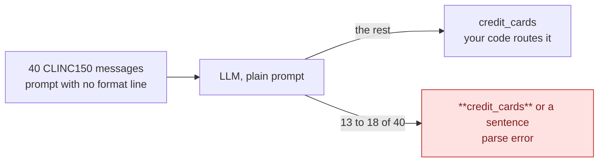

### Slide 3 · A schema fixes the format, not the doubt

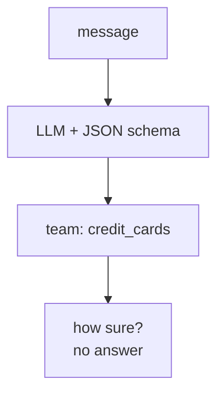

### Slide 4 · Jev answers questions. It never writes text.

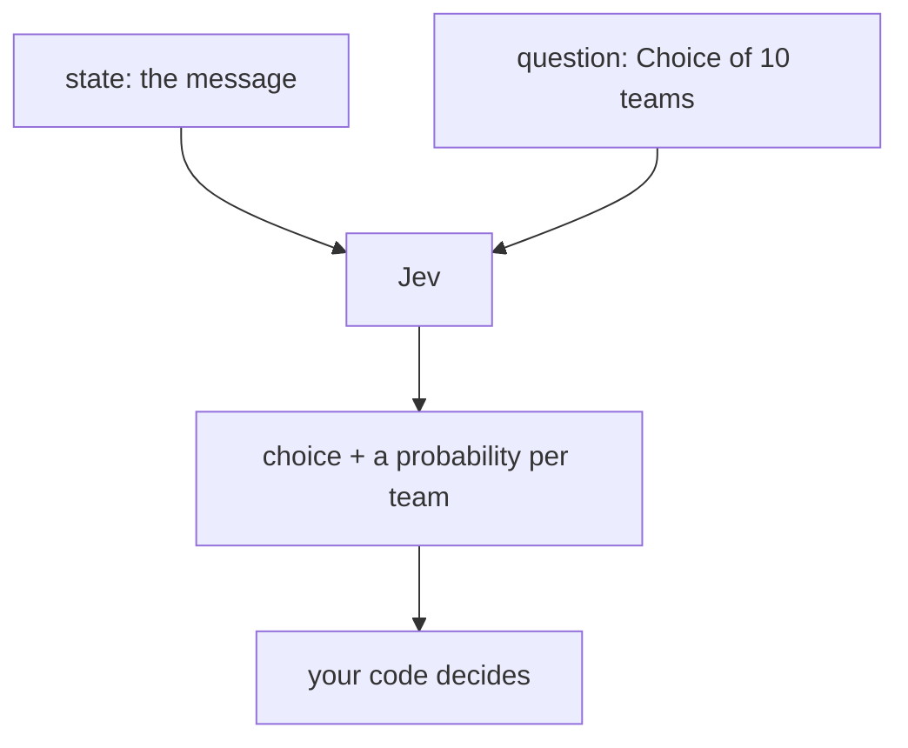

### Slide 5 · Accuracy within noise, 4x faster, 12x cheaper

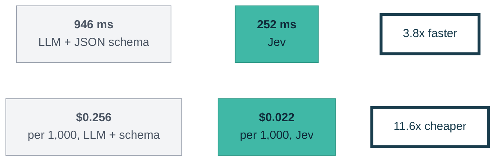

### Slide 6 · One request, three kinds of question

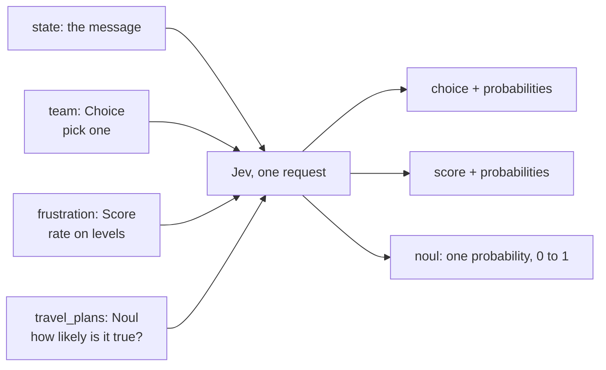

### Slide 7 · Read the distribution, not only the top answer

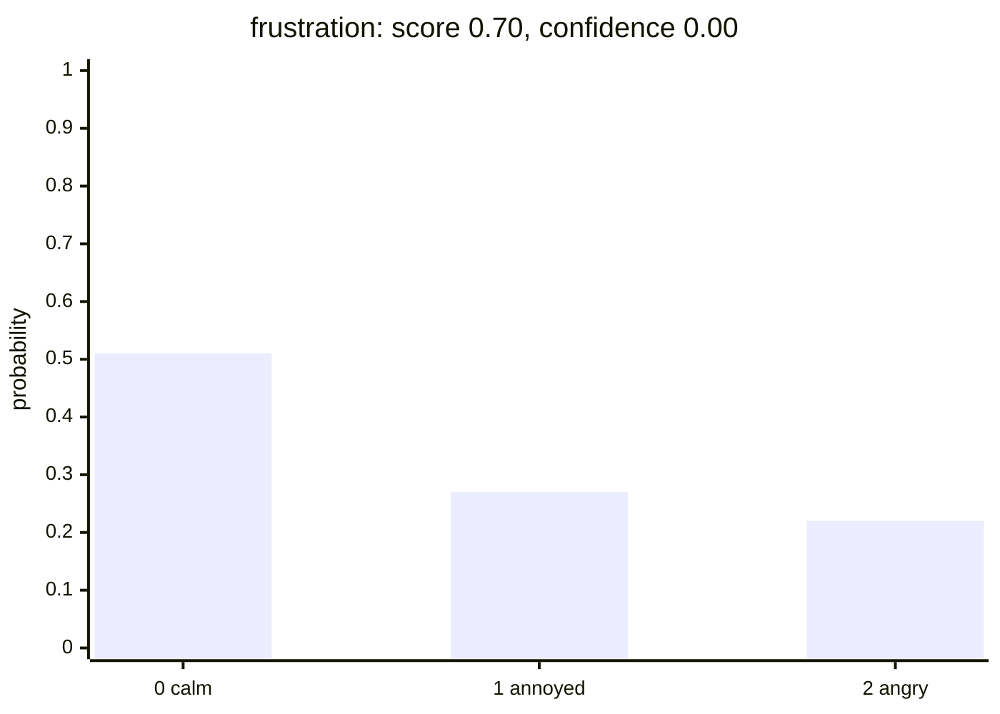

### Slide 8 · Rules in Python, not in the prompt

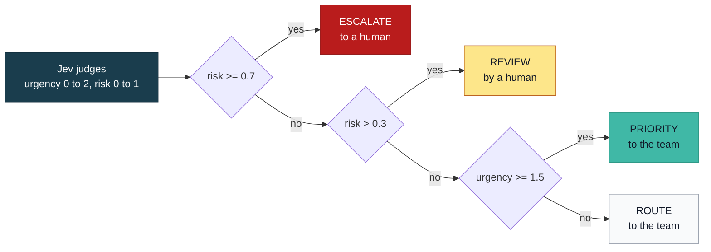

### Slide 9 · Lab 1: Build triage() in one call

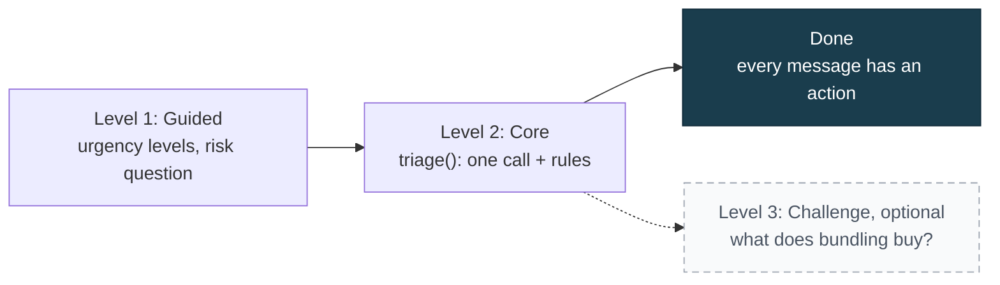

### Slide 10 · Urgent is not risky: the declined card

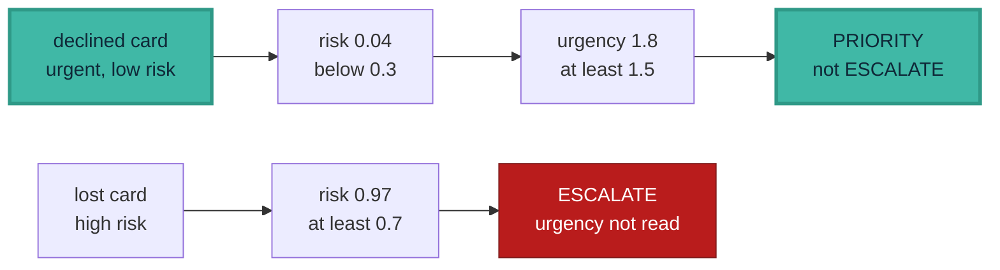

### Slide 11 · Jev always picks a team, even when none fits

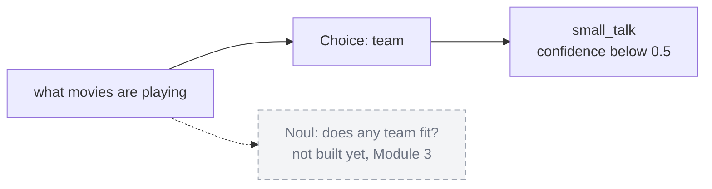

### Slide 12 · Jev judges, your code decides

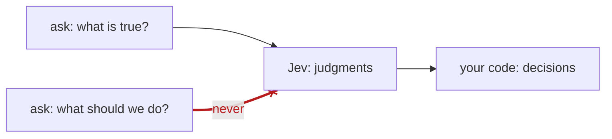
