# Module 1: Meet Jev: Typed Decisions Instead of Text, Slide Diagrams

| Slide | Title | Layout | Mermaid type |
| --- | --- | --- | --- |
| 1 | Getting Started with Jev | title slide | none |
| 2 | The reply that breaks your parser | points left, diagram right | flowchart |
| 3 | What a JSON schema cannot give you | points left, diagram right | flowchart |
| 4 | System One: judgments, not text | points left, diagram right | flowchart |
| 5 | Accuracy within noise, 4x faster, 12x cheaper | points left, diagram right | flowchart |
| 6 | One state, several questions | full diagram | flowchart |
| 7 | Read the distribution, not only the top answer | points left, diagram right | xychart-beta |
| 8 | Judgments in Jev, decisions in code | full diagram | flowchart |
| 9 | Lab 1: Triage in one call | lab holding slide | flowchart |
| 10 | Urgent is not risky: the declined card | points left, diagram right | flowchart |
| 11 | A Choice always picks a team | points left, diagram right | flowchart |
| 12 | Jev judges, your code decides | points left, diagram right | flowchart |

### Slide 2 · The reply that breaks your parser

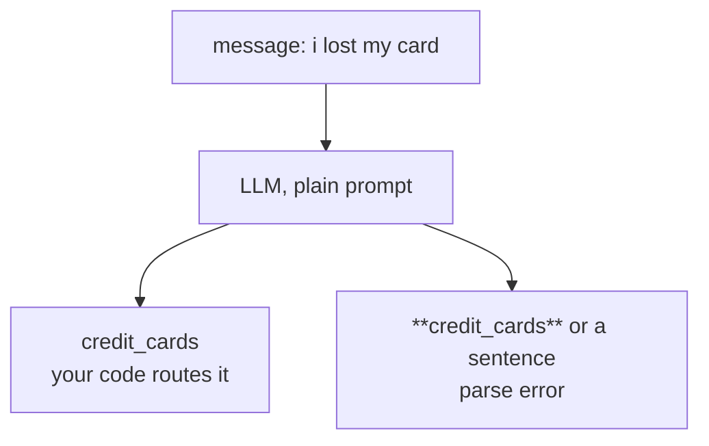

### Slide 3 · What a JSON schema cannot give you

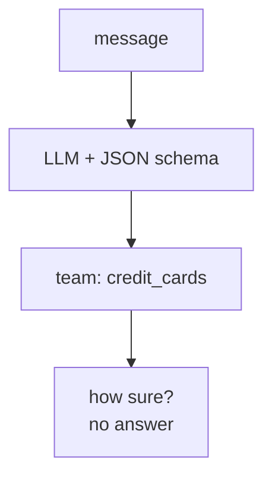

### Slide 4 · System One: judgments, not text

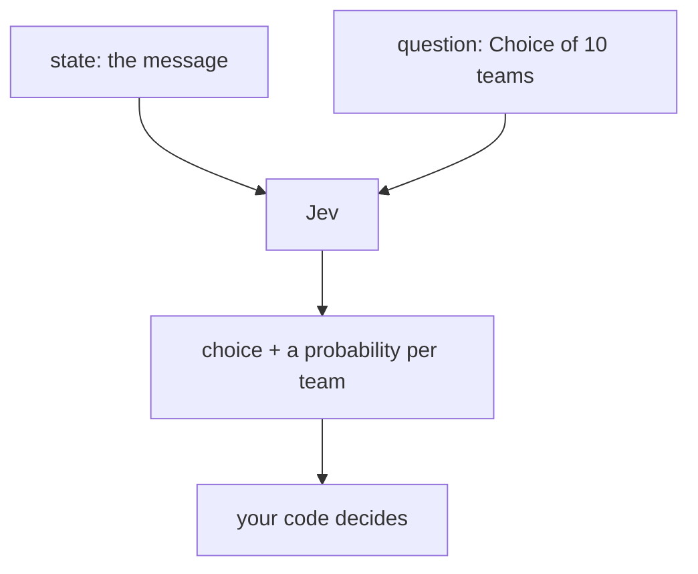

### Slide 5 · Accuracy within noise, 4x faster, 12x cheaper

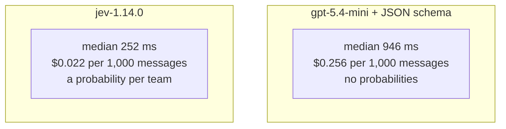

### Slide 6 · One state, several questions

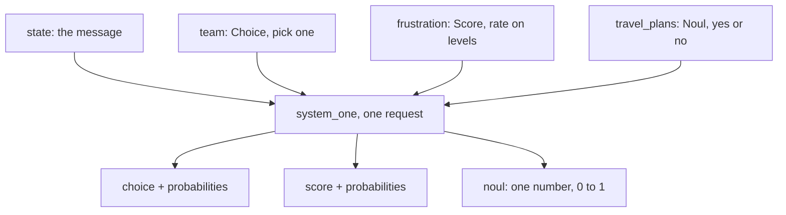

### Slide 7 · Read the distribution, not only the top answer

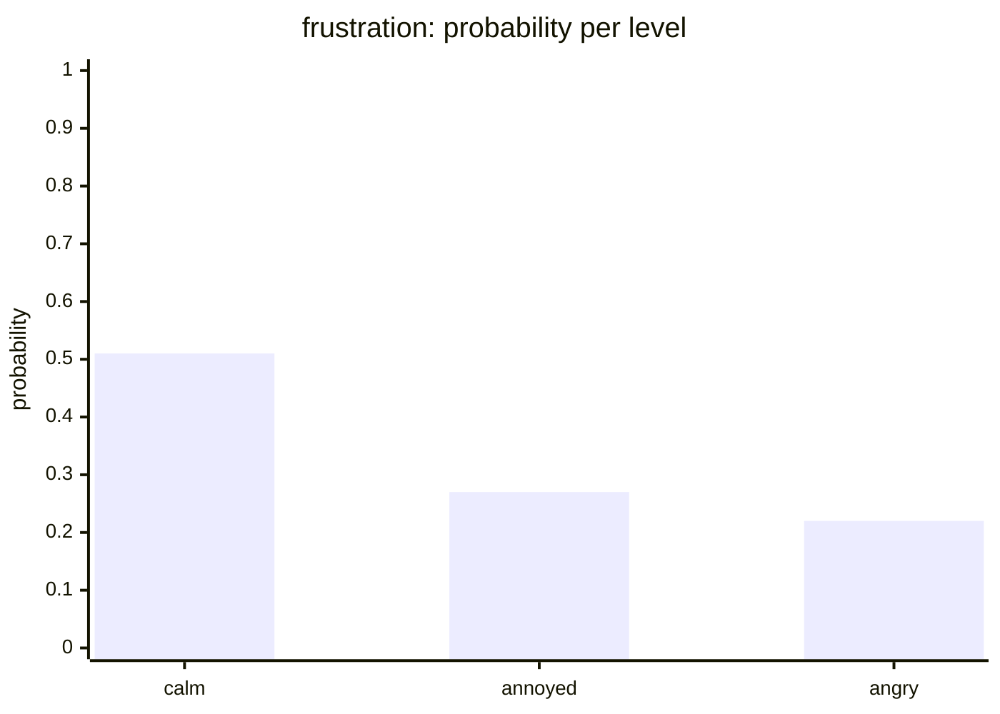

### Slide 8 · Judgments in Jev, decisions in code

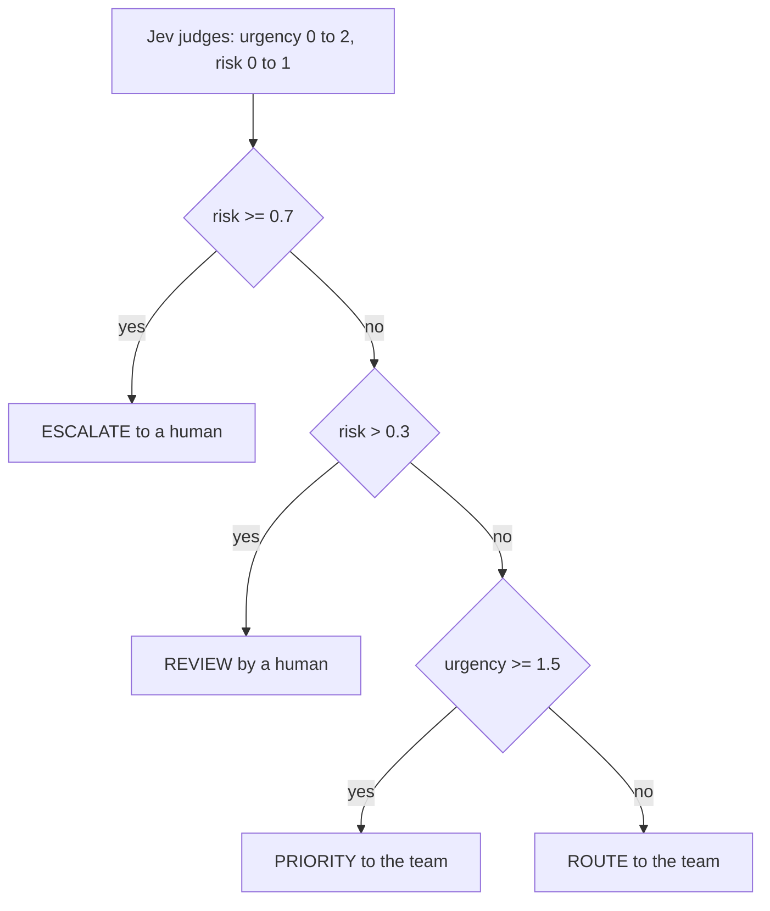

### Slide 9 · Lab 1: Triage in one call

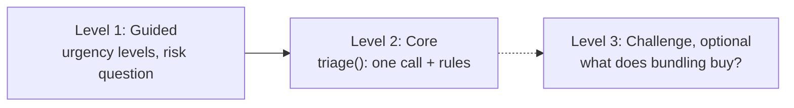

### Slide 10 · Urgent is not risky: the declined card

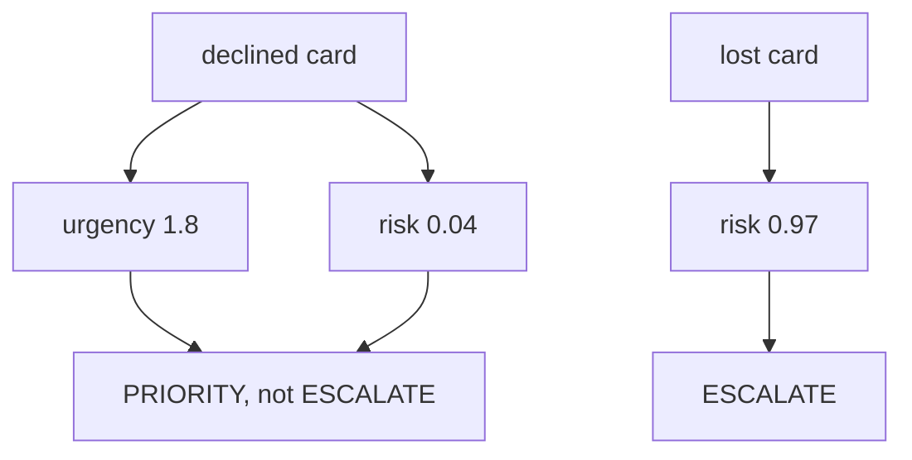

### Slide 11 · A Choice always picks a team

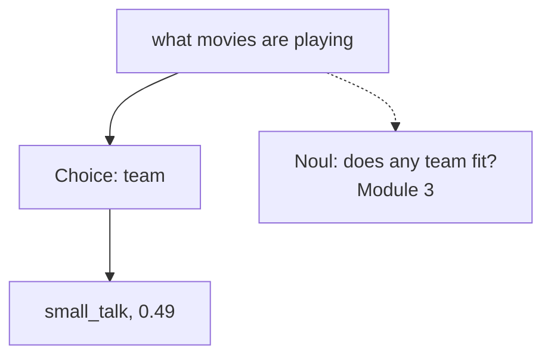

### Slide 12 · Jev judges, your code decides

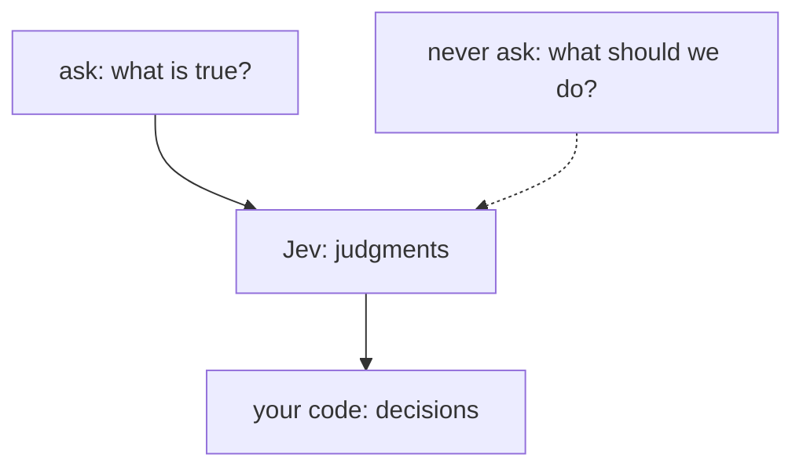
