# Module 1: Meet Jev: Typed Decisions Instead of Text, Slides

## Run of show

| Step | Slides | What happens |
| --- | --- | --- |
| Hook | 1 to 4 | The reply that breaks a parser, what a schema cannot give you, System One, a prediction; badge to Demo 1 |
| Notebook: Demo 1 | none | Setup cells, then 40 messages three ways: plain prompt, JSON schema, Jev |
| Read the result | 5 to 6 | The measured answer to the prediction; one state, several questions; badge to Demo 2 |
| Notebook: Demo 2 | none | One request, three question types, every field, alias vs pinned |
| Decisions in code | 7 to 9 | Read the distribution, the rules in Python, the lab in three levels; badge to Lab 1 |
| Notebook: Lab 1 | none | Level 1 Guided, Level 2 Core, Level 3 Challenge (optional) |
| Debrief | 10 to 12 | The declined card, a Choice always picks, the one takeaway |

## Slides

### Slide 1 · Getting Started with Jev

Layout: title slide

Jev judges. Your code decides. An LLM writes the replies.

Say: Welcome. Over four hours we build one thing: a triage layer that reads a message and decides where it goes. Module 1 starts with the question every team asks first: why not just use an LLM?

### Slide 2 · The reply that breaks your parser

Layout: points left, diagram right

- 40 real assistant messages from CLINC150, 10 teams to route to
- Plain prompt: 18 of 40 replies were not a bare team name
- Markdown bold, or a full sentence your code has to parse

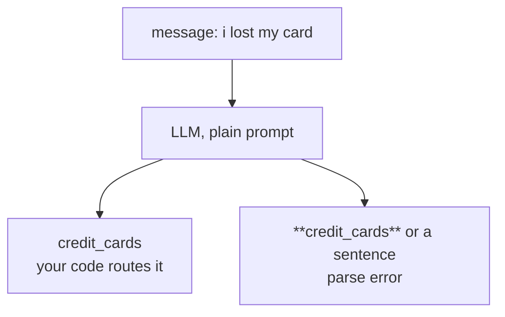

Say: this is how most LLM triage starts: a prompt that lists the teams and a parser that hopes the reply is one of them. On our 40 messages almost half came back wrapped in markdown or as a sentence.

Source: measured in this course on 2026-10-30 (gpt-5.4-mini-2026-03-17, 40 CLINC150 messages); [CLINC150 on Hugging Face](https://huggingface.co/datasets/clinc/clinc_oos)

### Slide 3 · What a JSON schema cannot give you

Layout: points left, diagram right

- A schema with an enum fixes the format: always a valid team
- It cannot tell you how sure the model was: 51% or 99%?
- So the escalation rule ends up hidden in the prompt

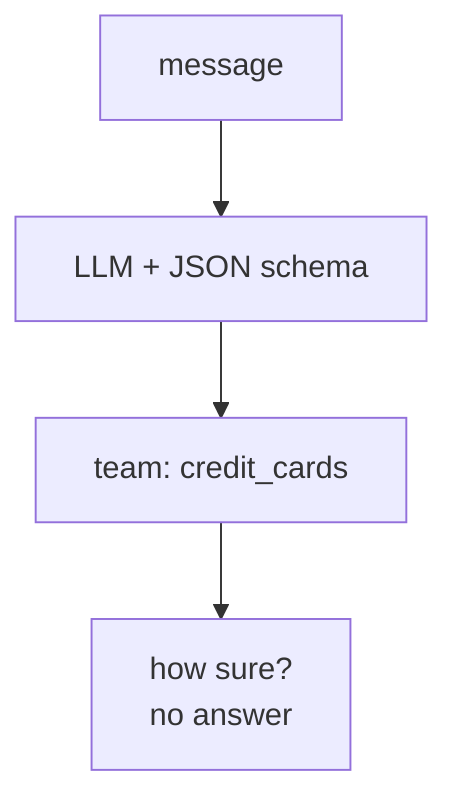

Say: give the LLM the fix every OpenAI user knows: a JSON schema whose enum is the 10 teams. The format problem is gone. What is still missing is a number your code can act on.

Source: [OpenAI: Structured outputs](https://developers.openai.com/api/docs/guides/structured-outputs)

### Slide 4 · System One: judgments, not text

Layout: points left, diagram right

Badge: "Switch to the notebook: Demo 1"

- System One model: makes quick typed judgments, writes no text
- You send a state and a question; Jev returns a typed answer
- Predict: same 40 messages, which is more accurate, faster, cheaper?

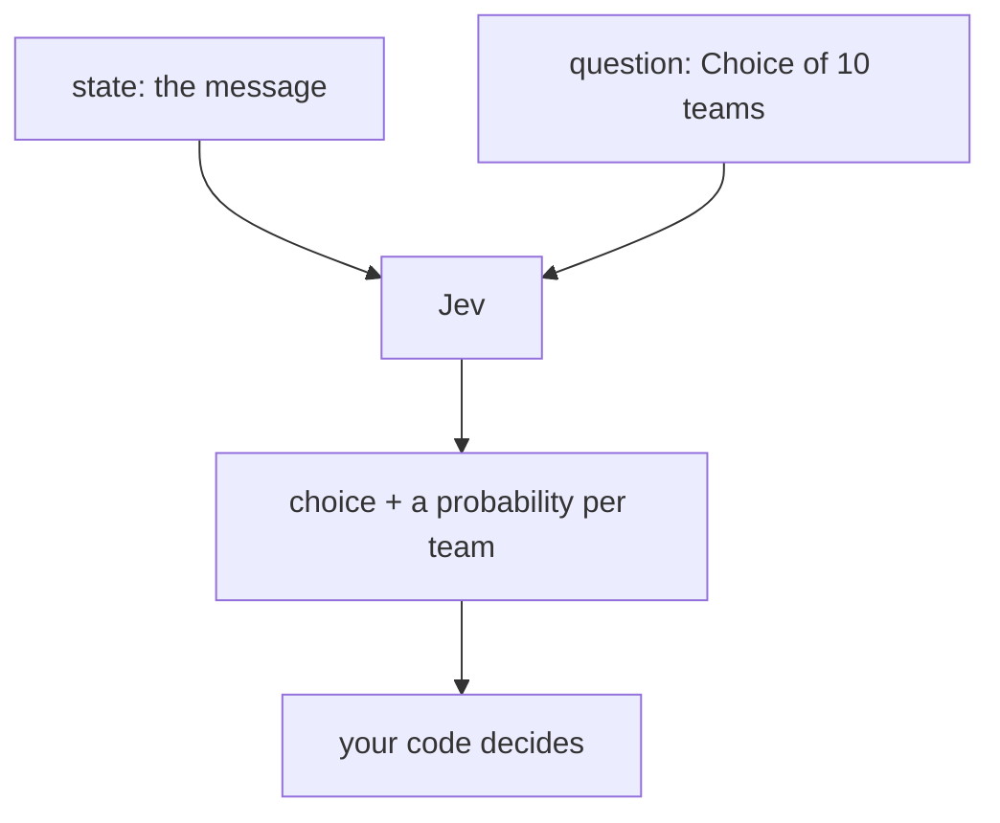

Say: Jev is TypeSafe's first System One model: it answers judgment questions instead of writing. Write down your prediction, open the notebook, run the setup cells, and we send the same 40 messages three ways.

Source: [TypeSafe docs: Introduction](https://docs.typesafe.ai), [TypeSafe docs: System One](https://docs.typesafe.ai/concepts/system-one.md)

### Slide 5 · Accuracy within noise, 4x faster, 12x cheaper

Layout: points left, diagram right

- Accuracy: 72.5% to 77.5% across our runs, within noise at 40 messages
- Only Jev returned a probability per team

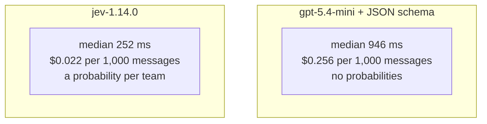

Say: with a schema the LLM was as accurate as Jev, and most misses on both sides were labels a person could argue about. Jev answered about 4 times faster, about 12 times cheaper, and gave your code a probability for every team.

Source: measured in this course on 2026-10-30; [OpenAI: GPT-5.4 mini pricing](https://developers.openai.com/api/docs/models/gpt-5.4-mini); [TypeSafe docs: Models](https://docs.typesafe.ai/go/models.md)

### Slide 6 · One state, several questions

Layout: full diagram

Badge: "Switch to the notebook: Demo 2"

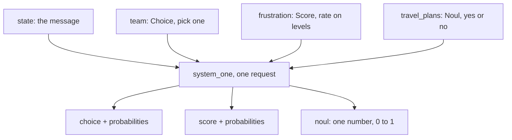

Say: three question types. A Choice picks one option, a Score rates on levels you describe, a Noul says how likely a statement is true. Each question is answered on its own against the same state. Back to the notebook: one request, all three.

Source: [TypeSafe docs: Primitives](https://docs.typesafe.ai/primitives.md), [TypeSafe docs: State](https://docs.typesafe.ai/concepts/state.md)

### Slide 7 · Read the distribution, not only the top answer

Layout: points left, diagram right

- Probabilities: how likely each option is
- Confidence: how much of the probability sits on one option
- Frustration scored 0.70 with confidence 0.00: Jev was split

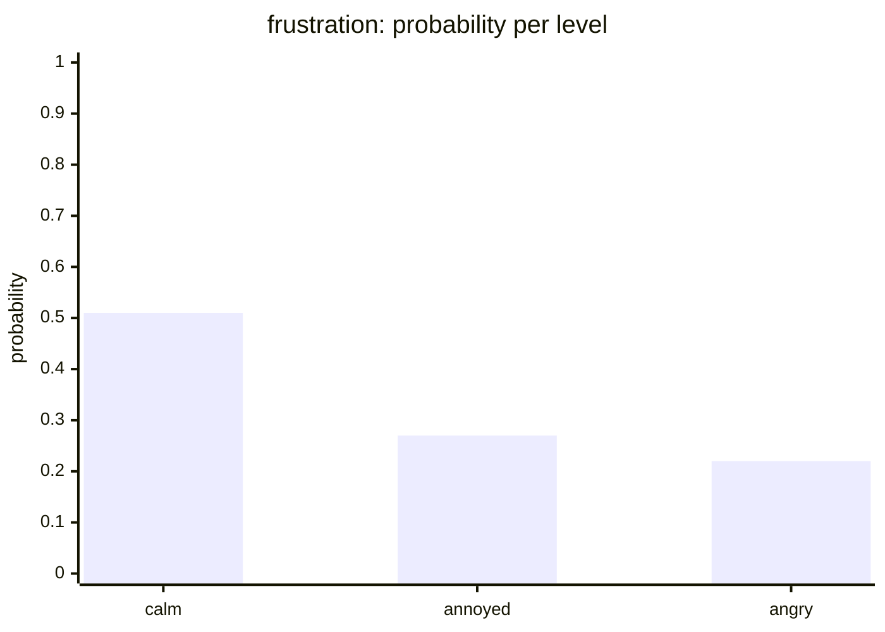

Say: the score alone said "a bit frustrated". The distribution says Jev could not settle it. Confidence is not the same as being right; Module 3 tests that. And log the model id: jev-latest moves, jev-1.14.0 does not.

Source: measured in this course on 2026-10-30; [TypeSafe docs: Confidence](https://docs.typesafe.ai/confidence.md)

### Slide 8 · Judgments in Jev, decisions in code

Layout: full diagram

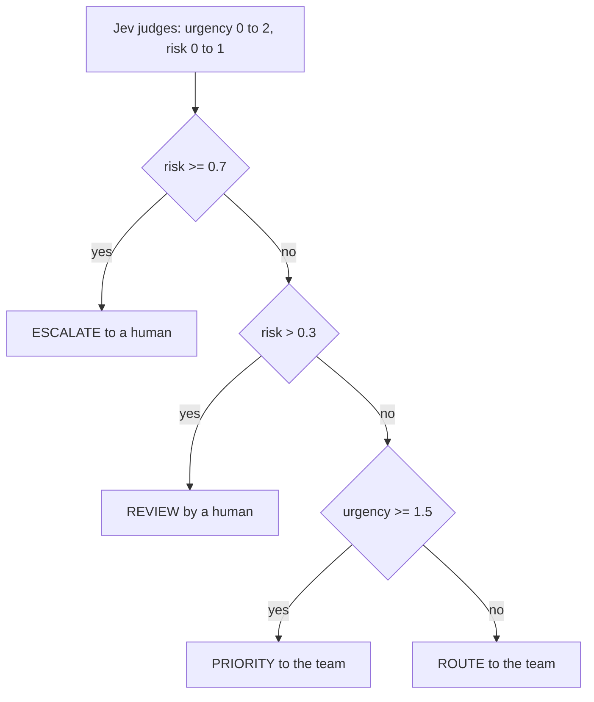

Say: never ask Jev "should we escalate?". Ask what is true: how urgent, how likely a risk. The rules live in Python, checked in this order, so a policy change is a threshold change, not a prompt rewrite.

Source: [TypeSafe docs: How to build with TypeSafe](https://docs.typesafe.ai/concepts/how-to-build-with-system-one.md), [TypeSafe agent skill](https://github.com/typesafe-ai/skills)

### Slide 9 · Lab 1: Triage in one call

Layout: lab holding slide. Strip: "Level 1, then Level 2. Level 3 if you have time. Done when every message has an action."

Badge: "Switch to the notebook: Lab 1"

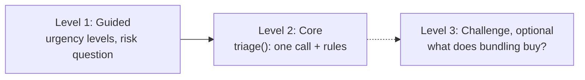

Say: Level 1 is two design decisions: how you describe urgency, and how you phrase risk. Level 2 is the function your product would ship. Stuck on Level 1? Run the FALLBACK cell and keep going.

### Slide 10 · Urgent is not risky: the declined card

Layout: points left, diagram right

- 12 messages: 3 ESCALATE, 2 REVIEW, 1 PRIORITY, 6 ROUTE
- The declined card was urgent but not a risk
- If you ran Level 3: one call read 630 tokens, three calls 1,175

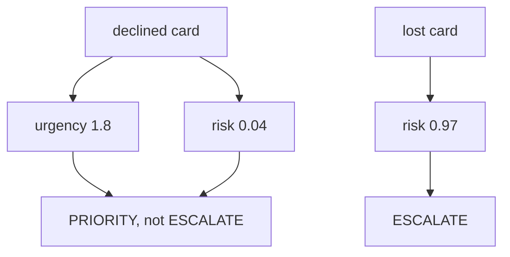

Say: separate questions for urgency and risk are what let the code tell these two apart. In Level 3, parallel calls were as fast as one bundled call; bundling pays off in cost, because the state is read once.

Source: measured in this course on 2026-10-30 (12 lab messages; Level 3 on 8 messages)

### Slide 11 · A Choice always picks a team

Layout: points left, diagram right

- "what movies are playing" fits none of our 10 teams
- Jev still picked one: small_talk, confidence 0.49
- Module 3 adds a Noul: does any team fit?

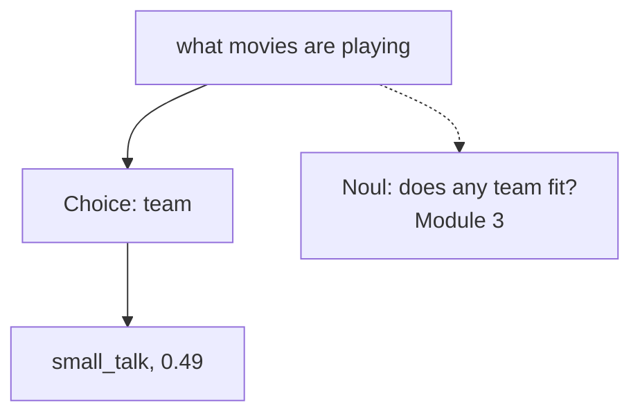

Say: a Choice always returns one of its options, even when none fits. The fix is a second question in the same request, a Noul that asks whether anything fits. We build that in Module 3.

Source: measured in this course on 2026-10-30; [TypeSafe agent skill: ask about the null case separately](https://github.com/typesafe-ai/skills)

### Slide 12 · Jev judges, your code decides

Layout: points left, diagram right

- Never ask Jev what to do; ask what is true
- Next: our risk question joins three conditions with "or"
- Module 2 splits it, so you know which risk fired

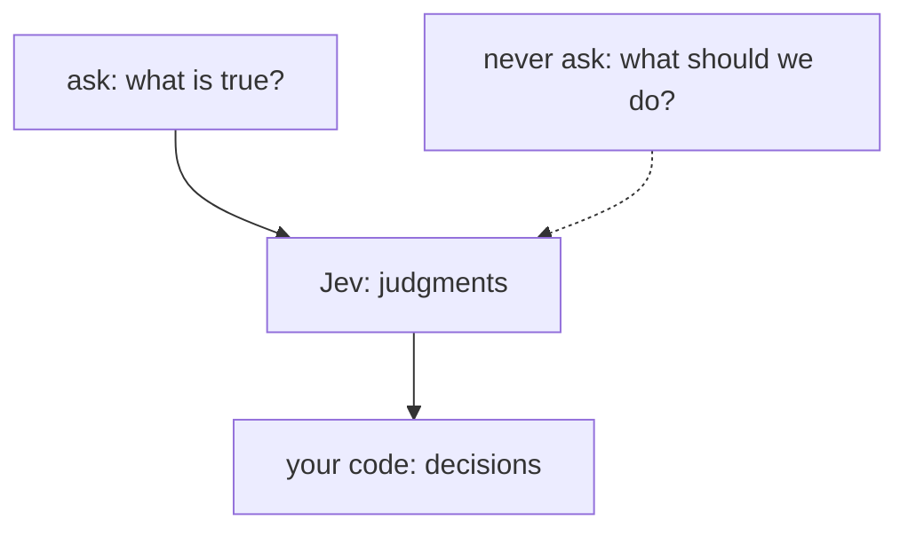

Say: if you remember one thing from this module: Jev judges, your code decides. Your triage() is the pattern we reuse for the rest of the course.

## Module 1 playbook

- Before slide 1: open the module 1 exercises notebook in Colab; keys ready to paste.
- Slide 4 badge: everyone runs cells 2 to 5 (install, keys, config, data). Then Demo 1, cells 7 to 11. Cell 10 makes 120 calls per person; if the shared keys slow down, run cell 10 once on the instructor screen and let the room watch the table.
- Slide 6 badge: Demo 2, cells 15 to 17. Point at the frustration probabilities: the score sits in the middle because the levels are split.
- Slide 9 badge: Lab 1. Walk the room at Level 1; most questions are about how to word the levels. Anyone stuck runs the FALLBACK cell and moves to Level 2. Backup if Jev rate-limits: pairs share one notebook.
- Slide 10: put the 12-row table from cell 23 on screen.

## Sources

- [TypeSafe docs: Introduction](https://docs.typesafe.ai)
- [TypeSafe docs: System One](https://docs.typesafe.ai/concepts/system-one.md)
- [TypeSafe docs: State](https://docs.typesafe.ai/concepts/state.md)
- [TypeSafe docs: Primitives](https://docs.typesafe.ai/primitives.md)
- [TypeSafe docs: Confidence](https://docs.typesafe.ai/confidence.md)
- [TypeSafe docs: Models](https://docs.typesafe.ai/go/models.md)
- [TypeSafe docs: How to build with TypeSafe](https://docs.typesafe.ai/concepts/how-to-build-with-system-one.md)
- [TypeSafe agent skill](https://github.com/typesafe-ai/skills)
- [OpenAI: GPT-5.4 mini](https://developers.openai.com/api/docs/models/gpt-5.4-mini)
- [OpenAI: Structured outputs](https://developers.openai.com/api/docs/guides/structured-outputs)
- [CLINC150 on Hugging Face](https://huggingface.co/datasets/clinc/clinc_oos), [CLINC oos-eval](https://github.com/clinc/oos-eval)
- Measured numbers: `plans/modules/module_01_plan.md`, live runs on 2026-10-30
