# Module 1: Meet Jev: Typed Decisions Instead of Text, Slides

## Run of show

| Step | Slides | What happens |
| --- | --- | --- |
| Hook | 1 to 4 | The reply that breaks a parser, what a schema cannot give you, what Jev is, a prediction; badge to Demo 1 |
| Notebook: Demo 1 | none | Setup cells, then 40 messages three ways: no format line, JSON schema, Jev |
| Read the result | 5 to 6 | The measured answer to the prediction; one request, three kinds of question; badge to Demo 2 |
| Notebook: Demo 2 | none | One request, three question types, every field, alias vs pinned |
| Decisions in code | 7 to 9 | Read the distribution, the rules in Python, the lab in three levels; badge to Lab 1 |
| Notebook: Lab 1 | none | Level 1 Guided, Level 2 Core, Level 3 Challenge (optional) |
| Debrief | 10 to 12 | The declined card, a Choice always picks, the one takeaway |

## Slides

### Slide 1 · Getting Started with Jev

Layout: title slide

Jev judges. Your code decides. An LLM writes the replies.

Say: Over four hours we build one thing: a triage layer that reads a message and decides where it goes. Module 1 starts with the question every team asks first: why not just use an LLM?

### Slide 2 · The reply that breaks your parser

Layout: full diagram. Strip under the diagram: "Prompt with no format line: 13 to 18 of 40 replies came back as markdown or a sentence"

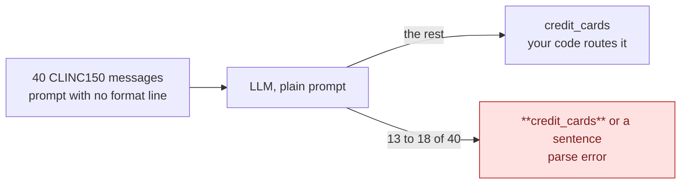

Say: This is how most LLM triage starts: a prompt that lists the teams and a parser that hopes. I left the format line out on purpose: with it the same model gave 40 of 40 clean names in our run, and the next slide turns that hope into a guarantee.

Source: measured in this course on 2026-10-30 (gpt-5.4-mini-2026-03-17, 40 CLINC150 messages, three runs); [CLINC150 on Hugging Face](https://huggingface.co/datasets/clinc/clinc_oos)

### Slide 3 · A schema fixes the format, not the doubt

Layout: points left, diagram right

- An enum in the schema: always a valid team
- No probability: was it 51% or 99%?
- No probability means no threshold you can set

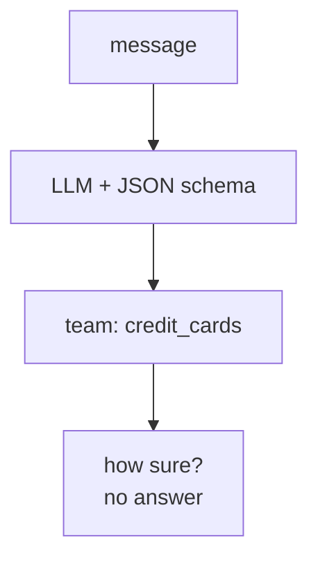

Say: Give the LLM the fix every OpenAI user knows: a JSON schema whose enum is the 10 teams. The format problem is gone, but there is still no number your code can act on.

Source: [OpenAI: Structured outputs](https://developers.openai.com/api/docs/guides/structured-outputs)

### Slide 4 · Jev answers questions. It never writes text.

Layout: points left, diagram right

Badge: "Switch to the notebook: Demo 1"

- Send a message and a question; get a probability for every option
- A System One model: fast typed judgments, no text
- Predict: on 40 messages, who is more accurate, faster, cheaper?

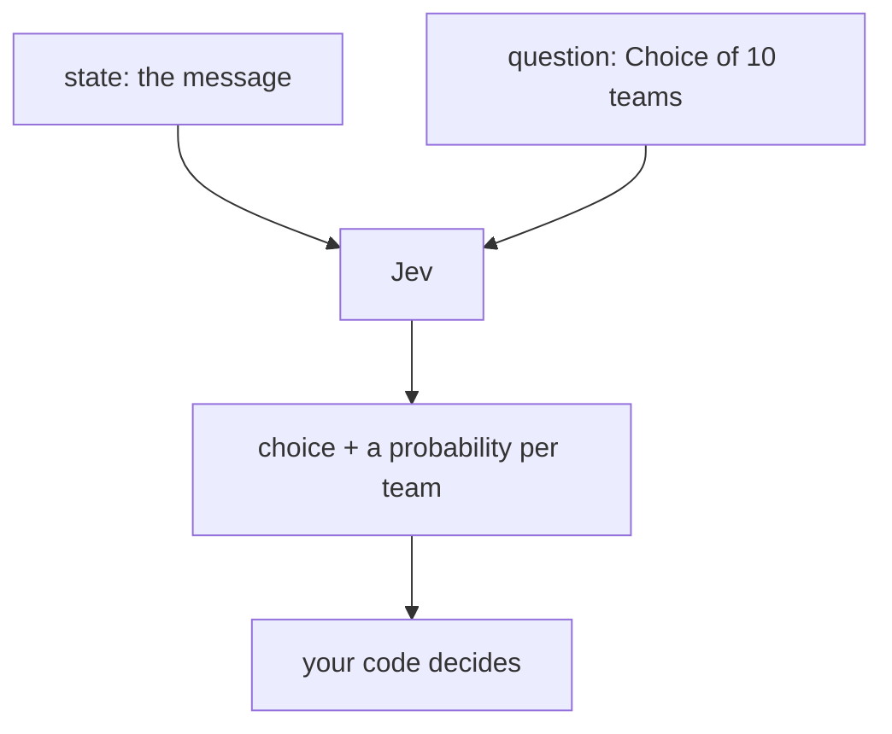

Say: Jev is TypeSafe's first System One model: it answers judgment questions and never writes text. Write down your prediction, then open the notebook, run the four Setup cells, and go to Demo 1.

Source: [TypeSafe docs: Introduction](https://docs.typesafe.ai), [TypeSafe docs: System One](https://docs.typesafe.ai/concepts/system-one.md)

### Slide 5 · Accuracy within noise, 4x faster, 12x cheaper

Layout: full diagram. Strip under the diagram: "Both 72.5% to 77.5% accurate on 40 messages. Only Jev returns a probability per team."

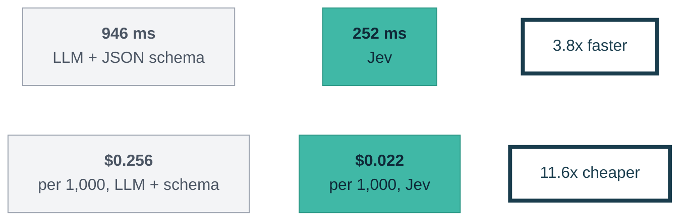

Say: In our runs the schema LLM and Jev were within noise on accuracy, and in our first run 10 of Jev's 11 misses were labels a person could argue about. Jev was 3x to 4x faster across three runs, about 12x cheaper, and the only one with a probability per team.

Source: measured in this course on 2026-10-30, median latency; [OpenAI: GPT-5.4 mini pricing](https://developers.openai.com/api/docs/models/gpt-5.4-mini); [TypeSafe docs: Models](https://docs.typesafe.ai/go/models.md)

### Slide 6 · One request, three kinds of question

Layout: full diagram

Badge: "Switch to the notebook: Demo 2"

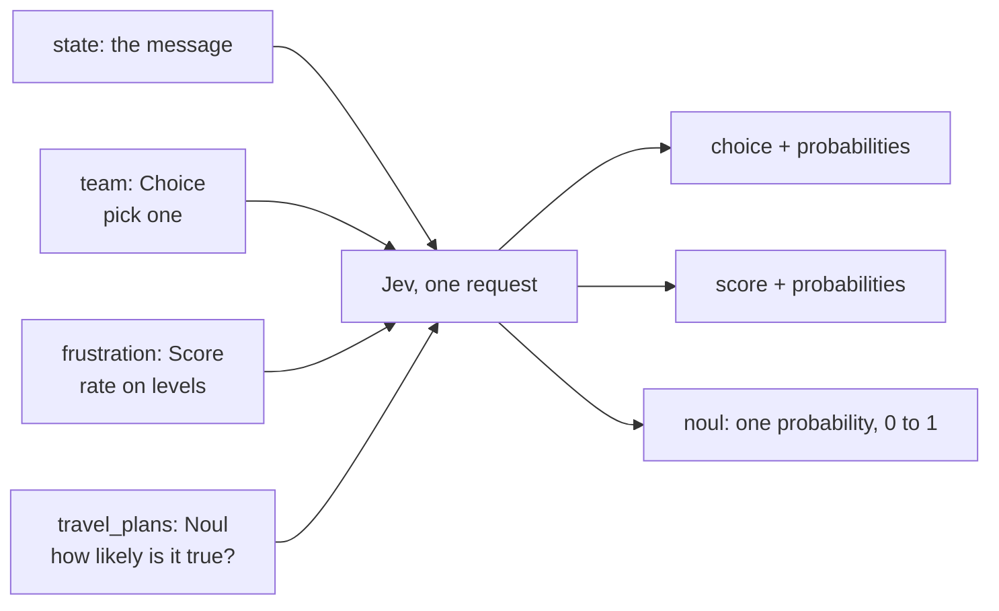

Say: A Choice picks one option, a Score rates on levels you describe, and a Noul says how likely a statement is true. Each question is answered on its own against the same state, all in one request.

Source: [TypeSafe docs: Primitives](https://docs.typesafe.ai/primitives.md), [TypeSafe docs: State](https://docs.typesafe.ai/concepts/state.md)

### Slide 7 · Read the distribution, not only the top answer

Layout: full diagram. Strip under the diagram: "Score 0.70 is the weighted average level. Confidence 0.00: as spread out as an even split."

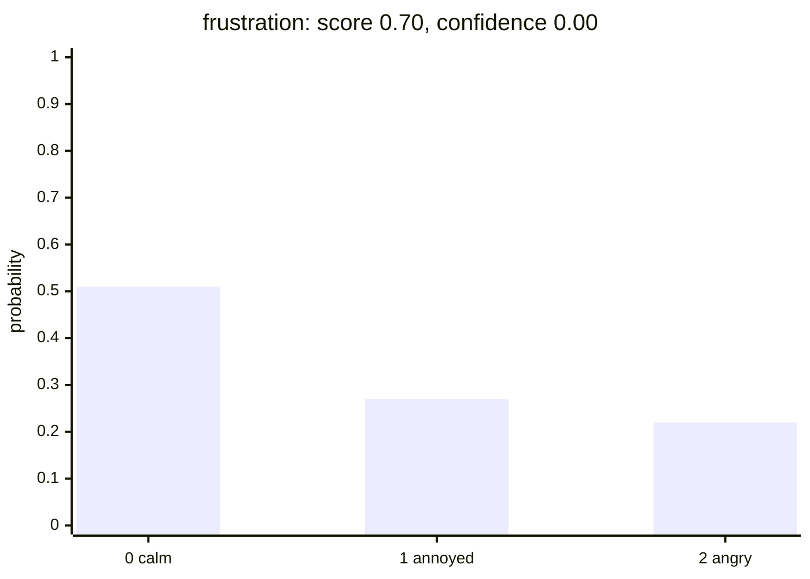

Say: Calm is the top level, but almost half the probability sits off it, 22% of it two levels away, so Score confidence floors at 0.00. Confidence measures spread, not correctness, and every response names the model that answered, so log it next to the decision.

Source: measured in this course on 2026-10-30; [TypeSafe docs: Confidence](https://docs.typesafe.ai/confidence.md)

### Slide 8 · Rules in Python, not in the prompt

Layout: full diagram. Strip under the diagram: "Change a threshold, not a prompt"

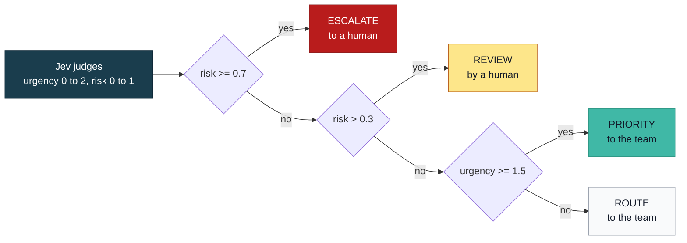

Say: Never ask Jev "should we escalate?"; ask what is true, and keep the rules in Python, checked in this order. 0.7 and 0.3 are TypeSafe's suggested starting thresholds for a Noul, and Module 3 checks them against data.

Source: [TypeSafe docs: How to build with TypeSafe](https://docs.typesafe.ai/concepts/how-to-build-with-system-one.md), [TypeSafe agent skill](https://github.com/typesafe-ai/skills)

### Slide 9 · Lab 1: Build triage() in one call

Layout: lab holding slide

Badge: "Switch to the notebook: Lab 1"

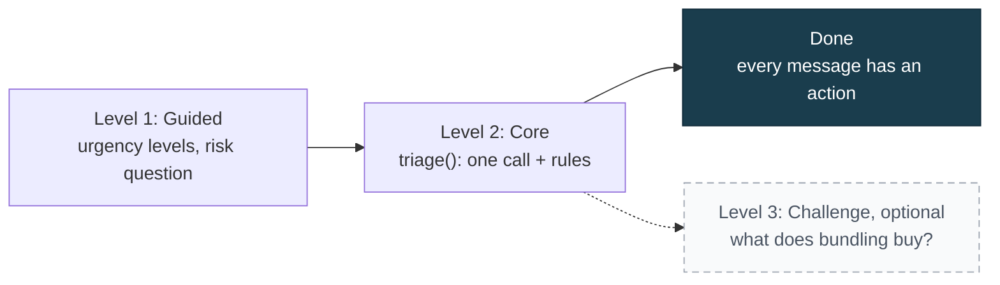

Say: Level 1 is two design decisions: how you describe urgency, and how you phrase risk. Level 2 is the function your product would ship.

### Slide 10 · Urgent is not risky: the declined card

Layout: full diagram. Strip under the diagram: "Separate questions for urgency and risk tell these two apart"

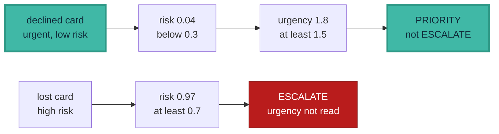

Say: The declined card never reaches the escalation rule: its risk is low, so the urgency rule decides. If you ran Level 3, one bundled call read 632 input tokens against 1,180 for three calls, and parallel calls matched its median speed.

Source: measured in this course on 2026-10-30 (12 lab messages)

### Slide 11 · Jev always picks a team, even when none fits

Layout: full diagram. Strip under the diagram: "Fix: a second question in the same request: does any team fit?"

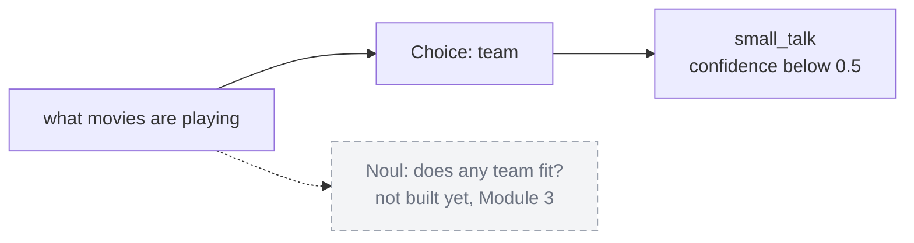

Say: A Choice always returns one of its options, even when none fits. The fix is a second question in the same request, a Noul that asks whether anything fits, and we build it in Module 3.

Source: measured in this course on 2026-10-30; [TypeSafe agent skill: ask about the null case separately](https://github.com/typesafe-ai/skills)

### Slide 12 · Jev judges, your code decides

Layout: full diagram. Strip under the diagram: "Ask what is true. Let your code decide."

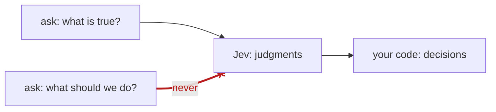

Say: If you remember one thing: Jev judges, your code decides, and your triage() is the pattern we reuse all course. Next, Module 2 splits our risk question, which joins three conditions with "or", so you know which risk fired.

## Module 1 playbook

- Before slide 1: open the module 1 exercises notebook in Colab; keys ready to paste.
- Slide 4 badge: everyone runs "Section 0: Setup" (install, keys, config, data), then "Demo 1". The "40 messages, three ways, one table" cell makes 120 calls per person; if the shared keys slow down, run it once on the instructor screen and let the room watch the table.
- Slide 6 badge: "Demo 2", its three DEMO cells. Point at the frustration probabilities: the score averages the levels, and confidence is 0.00 because the probability is spread.
- Slide 9 badge: "Lab 1". Walk the room at Level 1; most questions are about how to word the levels. Anyone stuck runs the FALLBACK cell (it fills only the empty slot) and moves to Level 2. Backup if Jev rate-limits: pairs share one notebook.
- Slide 10: put the LAB 1.2 table on screen, then its sorted risk line, and ask where the room would put the cut-offs.

## Sources

- [TypeSafe docs: Introduction](https://docs.typesafe.ai)
- [TypeSafe docs: System One](https://docs.typesafe.ai/concepts/system-one.md)
- [TypeSafe docs: State](https://docs.typesafe.ai/concepts/state.md)
- [TypeSafe docs: Primitives](https://docs.typesafe.ai/primitives.md)
- [TypeSafe docs: Confidence](https://docs.typesafe.ai/confidence.md)
- [TypeSafe docs: Models](https://docs.typesafe.ai/go/models.md)
- [TypeSafe docs: How to build with TypeSafe](https://docs.typesafe.ai/concepts/how-to-build-with-system-one.md)
- [TypeSafe agent skill](https://github.com/typesafe-ai/skills)
- [OpenAI: GPT-5.4 mini](https://developers.openai.com/api/docs/models/gpt-5.4-mini)
- [OpenAI: Structured outputs](https://developers.openai.com/api/docs/guides/structured-outputs)
- [CLINC150 on Hugging Face](https://huggingface.co/datasets/clinc/clinc_oos), [CLINC oos-eval](https://github.com/clinc/oos-eval)
- Measured numbers: `plans/modules/module_01_plan.md`, live runs on 2026-10-30
