# Platform Engineering Foundations: Slide Diagrams (Barclays)

Sep 29, 2026 · @Axel

Every slide diagram as raw Mermaid, keyed by slide number, in deck order. 30 diagrams: slide 1 is the title slide and has none. Export as `DIAGRAMS.md` next to `SLIDES.md` and render them on your laptop; titles and layouts match the [slide plan](https://claude.ai/code/artifact/840c85f2-47b5-4cf9-89eb-7c6057db591e).

## Index

Layouts: split is points left with the diagram right, full is the diagram as the whole body, demo is a holding slide shown while the Colab is on screen.

| Slide | Title | Layout | Mermaid type |
| --- | --- | --- | --- |
| 01 | Platform Engineering Foundations | title | none |
| 02 | Today's route | full | flowchart |
| 03 | The ticket test | split | sequenceDiagram |
| 04 | Why platforms, why now | split | flowchart |
| 05 | Ops vs DevOps vs platform engineering | full | flowchart |
| 06 | It's not a rebrand if it passes the ticket test | split | xychart-beta |
| 07 | What an IDP actually is | split | mindmap |
| 08 | Reference architecture: five planes | full | flowchart |
| 09 | Anatomy of a golden path | split | flowchart |
| 10 | Demo 1: new service in minutes | split | sequenceDiagram |
| 11 | When a rule breaks | split | flowchart |
| 12 | Debrief: what just happened | split | flowchart |
| 13 | From project to product | split | flowchart |
| 14 | How the platform team works with everyone else | split | stateDiagram-v2 |
| 15 | Buyer vs user | split | flowchart |
| 16 | Who owns the platform product today | split | pie |
| 17 | Build the roadmap from developer journeys | split | quadrantChart |
| 18 | The platform API is the product | split | flowchart |
| 19 | Golden path vs golden cage | split | flowchart |
| 20 | Why one metric lies | split | flowchart |
| 21 | Demo 2: the platform team's dashboard | split | flowchart |
| 22 | Live in Colab | demo | flowchart |
| 23 | Debrief: read adoption and satisfaction together | split | quadrantChart |
| 24 | How adoption actually happens | split | pie |
| 25 | Four barriers that stall adoption | full | flowchart |
| 26 | Demo 3: three ways to roll out the same tool | split | flowchart |
| 27 | Live: the rollout simulator | demo | timeline |
| 28 | Debrief: mandate the outcome, pave the path | split | flowchart |
| 29 | Early adoption playbook | full | flowchart |
| 30 | What to take back | split | flowchart |
| 31 | Q&A, and one thing to do this week | split | flowchart |

## Opening

### Slide 02 · Today's route

Layout: full

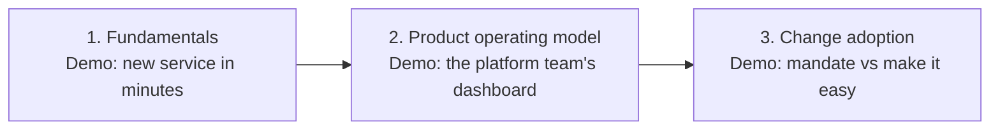

### Slide 03 · The ticket test

Layout: split

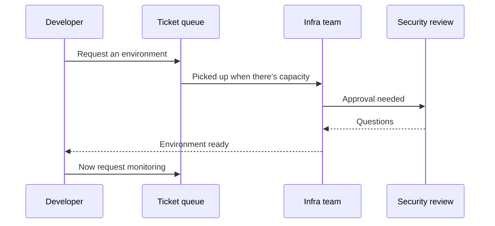

## Module 1: Platform Engineering Fundamentals

### Slide 04 · Why platforms, why now

Layout: split

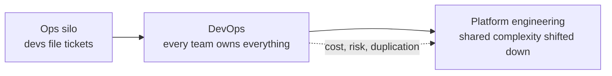

### Slide 05 · Ops vs DevOps vs platform engineering

Layout: full

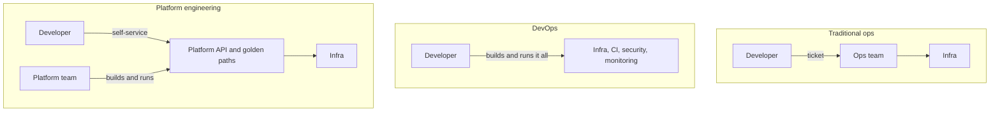

### Slide 06 · It's not a rebrand if it passes the ticket test

Layout: split

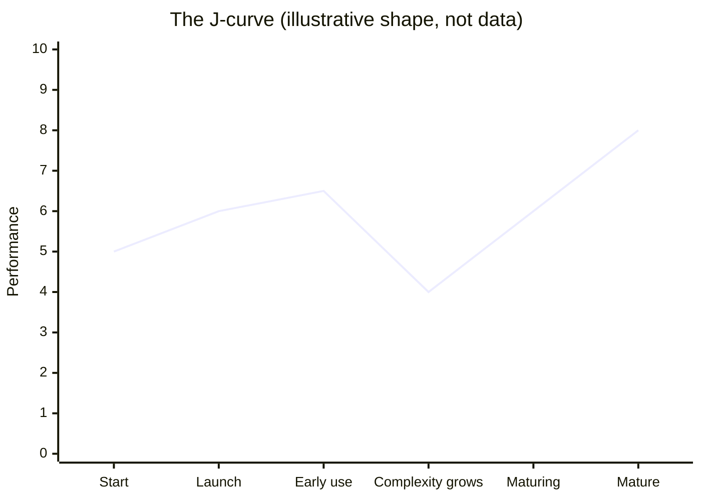

### Slide 07 · What an IDP actually is

Layout: split

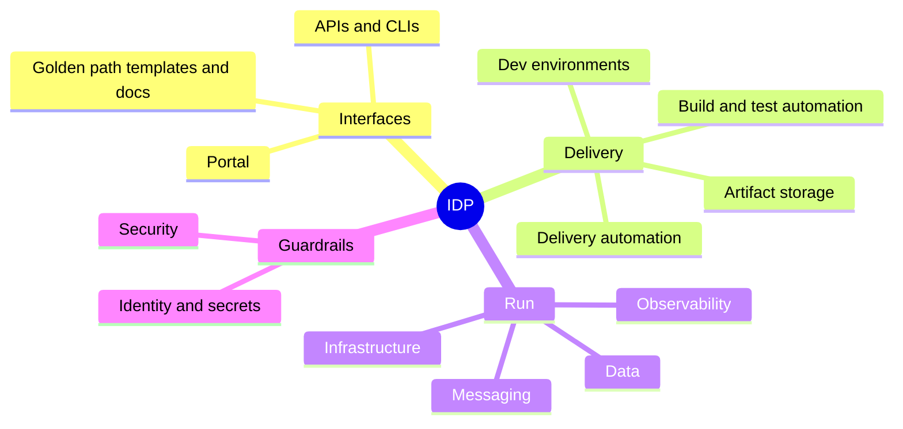

### Slide 08 · Reference architecture: five planes

Layout: full

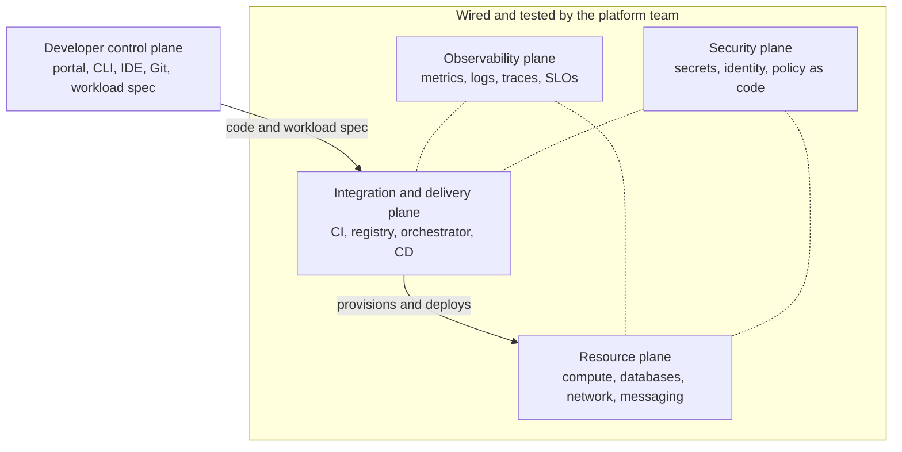

### Slide 09 · Anatomy of a golden path

Layout: split

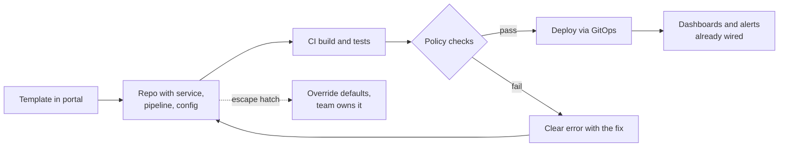

### Slide 10 · Demo 1: new service in minutes

Layout: split

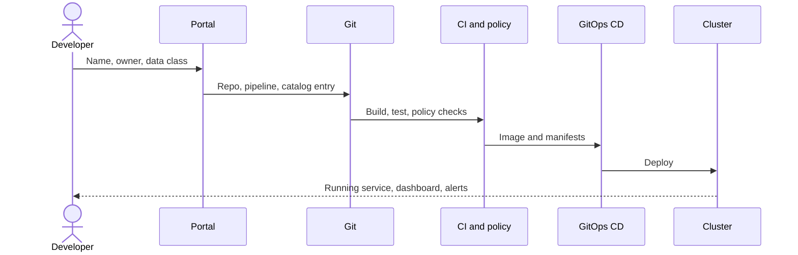

### Slide 11 · When a rule breaks

Layout: split

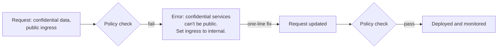

### Slide 12 · Debrief: what just happened

Layout: split

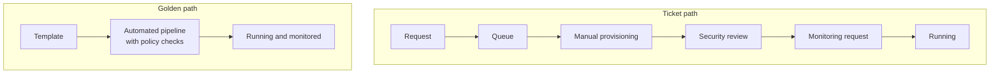

## Module 2: Product Operating Models for Platform Teams

### Slide 13 · From project to product

Layout: split

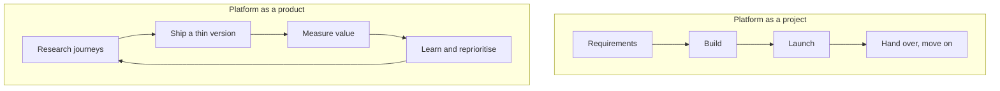

### Slide 14 · How the platform team works with everyone else

Layout: split

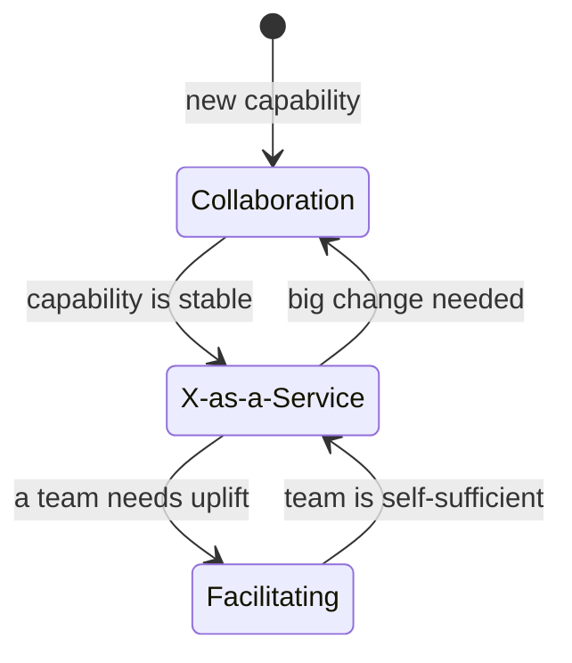

### Slide 15 · Buyer vs user

Layout: split

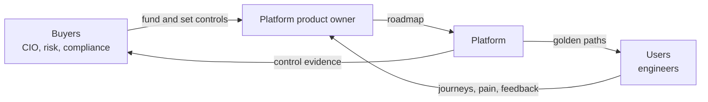

### Slide 16 · Who owns the platform product today

Layout: split

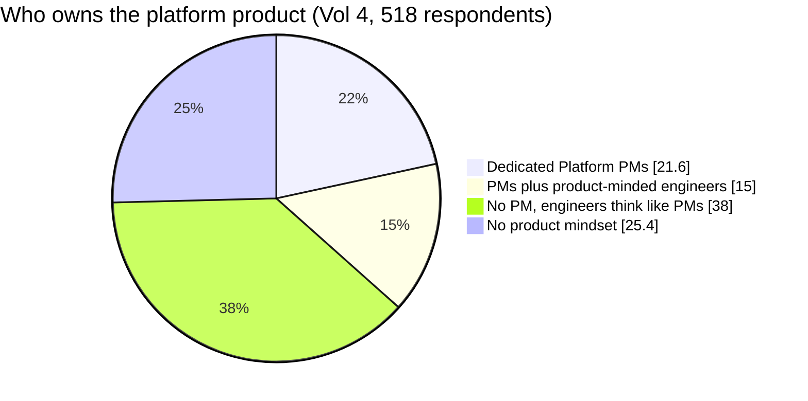

### Slide 17 · Build the roadmap from developer journeys

Layout: split

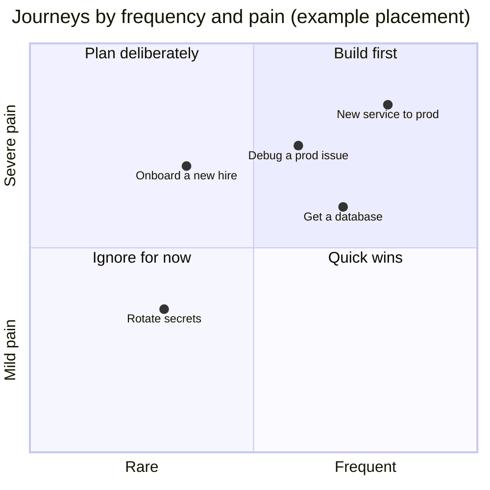

### Slide 18 · The platform API is the product

Layout: split

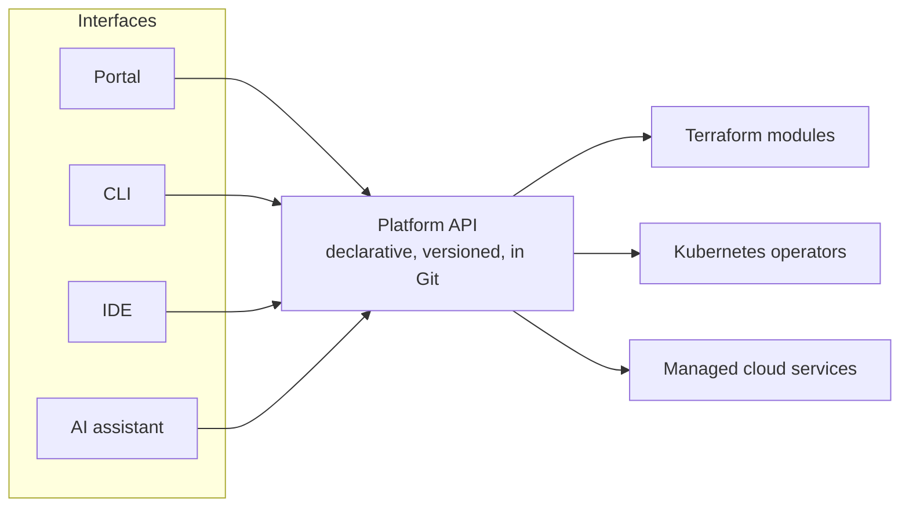

### Slide 19 · Golden path vs golden cage

Layout: split

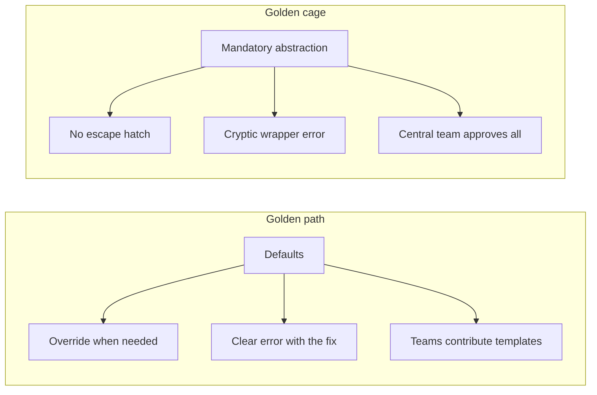

### Slide 20 · Why one metric lies

Layout: split

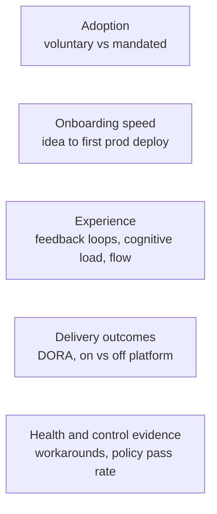

### Slide 21 · Demo 2: the platform team's dashboard

Layout: split

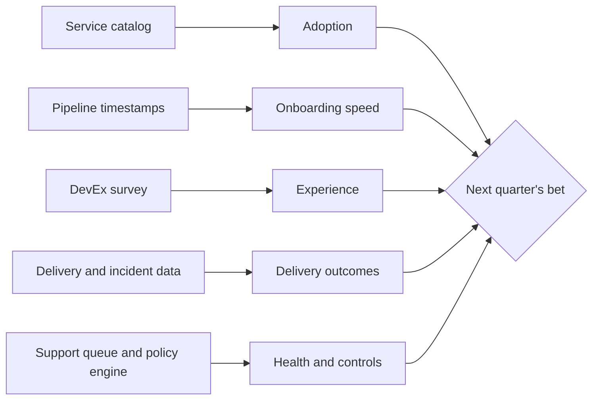

### Slide 22 · Live in Colab

Layout: demo

```mermaid
flowchart LR
  H[Headline only] -->|Peel| L["Six layers, one per click"]
  L --> T[Flip CI mandated off]
  T --> B{Pick one bet}
  B -->|Play quarter| N[Next quarter with deltas]
  N -->|up to Q4| B
```

### Slide 23 · Debrief: read adoption and satisfaction together

Layout: split

```mermaid
quadrantChart
  title Adoption vs satisfaction (synthetic demo data)
  x-axis Low adoption --> High adoption
  y-axis Low satisfaction --> High satisfaction
  quadrant-1 Healthy product
  quadrant-2 Hidden gem
  quadrant-3 Rethink or retire
  quadrant-4 Likely a golden cage
  CI pipelines: [0.85, 0.25]
  Databases: [0.65, 0.75]
  Secrets: [0.3, 0.8]
  Preview environments: [0.2, 0.3]
```

## Module 3: Change Adoption Basics

### Slide 24 · How adoption actually happens

Layout: split

```mermaid
pie showData
  title How platform adoption happens (Vol 4)
  "Mandate (extrinsic push)" : 36.6
  "Genuine pull (intrinsic)" : 28.2
  "Participatory (users contribute)" : 18.3
  "Erratic, no strategy" : 16.9
```

### Slide 25 · Four barriers that stall adoption

Layout: full

```mermaid
flowchart LR
  B1[Built without asking users] --> S1[Solves problems nobody has]
  B2["Slow v1 in the J-curve dip"] --> S2[Teams wait it out]
  B3["Golden cage, no escape hatch"] --> S3[Workarounds and shadow IT]
  B4["No sponsor, buyer and user pulling apart"] --> S4[Funding cut before value shows]
```

### Slide 26 · Demo 3: three ways to roll out the same tool

Layout: split

```mermaid
flowchart TB
  T[Same new deployment pipeline] --> A["Division A<br/>mandate the tool"]
  T --> B["Division B<br/>pave the path"]
  T --> C["Division C<br/>mandate the outcome, pave the path"]
  A --> Q{Month 6: who's better off?}
  B --> Q
  C --> Q
```

### Slide 27 · Live: the rollout simulator

Layout: demo

```mermaid
timeline
  title Three rollouts of the same pipeline (illustrative scenario)
  section Division A, mandate the tool
    Month 1 : Deadline announced : Teams migrate under pressure
    Month 3 : High adoption on paper : Wrapper scripts appear
    Month 6 : Complaints go quiet : Gaps hidden in workarounds
  section Division B, pave the path
    Month 1 : Three pilot teams : Built with them
    Month 3 : Before and after numbers published : Champions demo it
    Month 6 : Next wave pulls it in : Old path gets a sunset date
  section Division C, mandate the outcome
    Month 1 : Controls announced with a deadline : Pilots build the golden path
    Month 3 : Golden path meets the controls by default : Off-path teams start proving their own
    Month 6 : Most teams on the path : Everyone else provably compliant
```

### Slide 28 · Debrief: mandate the outcome, pave the path

Layout: split

```mermaid
flowchart LR
  M["Mandated outcome<br/>control set for every prod service"] --> Q{How will a team comply?}
  Q -->|golden path| G["Controls built in,<br/>evidence automatic"]
  Q -->|own route| O["Team proves each control<br/>and carries the cost"]
  G --> W[The paved road becomes the easy, obvious choice]
```

### Slide 29 · Early adoption playbook

Layout: full

```mermaid
flowchart TB
  s1[Pick one frequent, painful journey] --> s2[Build with 2 to 3 pilot teams]
  s2 --> s3[Ship a thin version in weeks]
  s3 --> s4[Publish before and after numbers]
  s4 --> s5[Pilots become champions]
  s5 --> s6[Next wave with enabling support]
  s6 --> s7[Only then, sunset the old path]
```

## Wrap-up

### Slide 30 · What to take back

Layout: split

```mermaid
flowchart TB
  a[Remove tickets and cognitive load] --> b[Build what developer journeys call for]
  b --> c[Run it as a product]
  c --> d["Versioned API, golden paths,<br/>layered scorecard"]
  d --> e[Mandate the outcome, pave the path]
  e --> f["At Barclays: governance first,<br/>several platforms, shared standards"]
```

### Slide 31 · Q&A, and one thing to do this week

Layout: split

```mermaid
flowchart LR
  j[Pick one painful journey] --> o[Name its owner]
  o --> m[Baseline it today]
  m --> p[Find 2 pilot teams]
```
