# Platform Engineering Foundations: Slide Plan (Barclays)

Sep 29, 2026 · @Axel

31 slides over 2 hours for an engineering audience, with three short live demos, one Colab each, shared as Gradio links. Questions to the room go in the Teams chat, no poll tool. Every slide follows one layout: up to 4 points on the left with a diagram on the right, or one full diagram. Evidence comes from the [6-cycle research doc](https://claude.ai/code/artifact/ca314c6f-56f1-41e2-9200-a608561de058); scope is the [course reference](https://claude.ai/code/artifact/820c31a5-3e0e-4c91-bc3e-bf8a1fc25e03).

## Run of show

Each module builds up to its demo, then debriefs it on the next slides.

| Block | Slides | Clock | Minutes | Demo |
| --- | --- | --- | --- | --- |
| Opening | 1 to 3 | 0:00 to 0:07 | 7 | Ticket test question in the chat |
| Module 1: Platform Engineering Fundamentals | 4 to 12 | 0:07 to 0:40 | 33 | Demo 1, Gradio portal with room catalog (10 min) |
| Break | none | 0:40 to 0:45 | 5 |  |
| Module 2: Product Operating Models | 13 to 23 | 0:45 to 1:20 | 35 | Demo 2, funding game (about 8 min) |
| Module 3: Change Adoption Basics | 24 to 29 | 1:20 to 1:48 | 28 | Demo 3, rollout simulator with divisions A, B and C (about 8 min) |
| Wrap-up and Q&A | 30 to 31 | 1:48 to 2:00 | 12 |  |

## Deck build spec for Claude Code

Claude Code builds the deck from the slide sections further down (Opening to Wrap-up). Every slide uses the same fields, so the build is mechanical. Export this doc as `SLIDES.md` and the [slide diagrams doc](https://claude.ai/code/artifact/7ba27b4f-4ab0-4d8b-ba94-f8b4c1e716d2) as `DIAGRAMS.md`, then paste the prompt below. It builds a local Reveal.js deck directly; your idea-to-deck pipeline would need the plan converted to its own outline format first.

| Field in each slide | Goes to |
| --- | --- |
| Heading "Slide N · Title" | Slide number and title |
| Layout line | Template: split, full, title or demo |
| Up to 4 points | Left column (split only) |
| Mermaid block | Right column (split) or the whole body (full, demo) |
| Say line | Speaker notes |
| Source line | Small footer, link titles only |

```text
Read SLIDES.md and DIAGRAMS.md. Build the "Platform Engineering Foundations" webinar deck for Barclays as a local Reveal.js deck.

SCOPE
- Build only the slides under the sections Opening, Module 1, Module 2, Module 3 and Wrap-up in SLIDES.md: 31 slides with headings "### Slide N · Title". Everything above them is context. Use the Demo 1 to 3 playbooks only for speaker notes.
- DIAGRAMS.md holds every slide's diagram as raw Mermaid, keyed by slide number. Use it as the diagram source. If a diagram there differs from the one in SLIDES.md, stop and ask me which is right.

OUTPUT
- deck/index.html with Reveal.js vendored locally (no CDN), the rendered diagrams next to it, deck/notes.md with all speaker notes in slide order, and deck/BUILD_REPORT.md.

TEMPLATES
- Map each slide's Layout line: "points left, diagram right" -> split; "full diagram" -> full; "title slide" -> title; any layout that mentions a holding slide -> demo. DIAGRAMS.md names the template directly.
- split: title on top, points left (40% width), diagram right (60%), both vertically centred.
- full: title on top, the diagram fills the rest.
- title: deck title, subtitle, date. No diagram.
- demo: title, the diagram as the holding visual, and a strip along the bottom: "Open the link in the Teams chat".

RULES
- Text is verbatim from the plan: titles, points and sources. Don't rewrite, don't add points. Max 4 points per slide; if a slide has more, stop and tell me.
- Render the Mermaid on this machine, themed to match the brand: mermaid-cli to SVG, or a vendored mermaid.js in the deck if that's simpler. Either way nothing loads from a CDN. If a diagram fails to render, keep the slide, show the Mermaid source in a monospace box, and list it in the build report.
- If a diagram is unreadable at 60% width (text under 18 px at 1920x1080), switch that slide to full and note it in the report.
- Speaker notes come from each slide's "Say:" line. For slides 10, 22 and 27, append the script from the matching Demo playbook.
- "Source:" lines become a small footer with the link titles.
- 16:9 at 1920x1080. Titles at least 44 px, points at least 28 px. It will be shared in Teams at 1280x720, so check it at that size too.
- Brand: Data Trainers defaults, teal #40B8A6 and navy #0D1E26, Poppins for titles and Inter for body, fonts vendored locally. Slide number bottom right. No animations or transitions.

BUILD REPORT
- A table of all 31 slides: number, title, template, diagram rendered yes or no, point count, notes present yes or no.
- Anything you changed from the plan, and why.

DONE WHEN
- All 31 slides render offline from index.html, every diagram renders, the report shows no missing notes, and speaker view (S key) shows the notes.
```

## Bringing the content to life

Each demo is its own Colab running a Gradio app, shared as a gradio.live link with a Hugging Face Space as backup. Colab 1 has a shared room catalog, Colab 2 is a funding game, Colab 3 simulates three divisions (A, B and C). The [demo build spec](https://claude.ai/code/artifact/1361dc02-2213-41d9-a6b3-912fbcb1d47d) is the source of truth for behaviour; the playbooks below cover timing and what to say.

| Colab | Course example | Built with | Slides |
| --- | --- | --- | --- |
| 1. Mini portal | Engineers spin up a new service themselves in minutes | Gradio form plus Python policy rules | 10 to 12 |
| 2. Platform team dashboard | Tracking adoption, onboarding speed and satisfaction | Gradio, pandas and plotly on synthetic data | 21 to 23 |
| 3. Rollout simulator | Mandating top-down vs making it the easy choice | Gradio sliders driving a toy adoption model | 26 to 28 |

## Demo 1, Gradio portal: new service in minutes (slides 10 to 12, 10 min)

The point: a team gets a service without a ticket, and the bank's controls still run. Everyone does it themselves from the Colab 1 link, and the room catalog shows the whole room doing it at once. App behaviour is in the demo build spec (Colab 1).

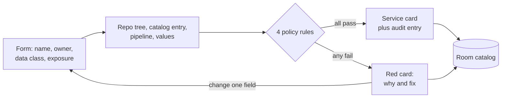

Script, 10 minutes:

1. On slide 10, paste the Colab 1 link in the Teams chat. Remind them of their slide 3 answers: this is the path we're replacing (2 min).
2. Everyone creates a valid service. Walk the generated files on your screen: all of this lives in Git, and that's the audit trail (2 min).
3. Everyone breaks it: Confidential data with Public internet exposure. Read the error together, fix one field, pass. Then try an override in Advanced and see the "you own this now" note (3 min).
4. Room catalog tab: how many services the room created, how many got blocked, the most common failed rule (1 min).
5. Switch to the pre-run GitHub Actions page: the same rule in a real pipeline, red, then green after the fix (2 min).

Slides 11 and 12 then debrief it. Backup: the Spaces link, the saved notebook outputs, and the Actions page is already pre-run.

## Demo 2, funding game: the platform team's dashboard (slides 21 to 23, about 8 min)

The point: headline adoption lies, so read the layers together, then fund one bet per quarter and live with it. Everyone plays their own game from the Colab 2 link. App behaviour is in the demo build spec (Colab 2).

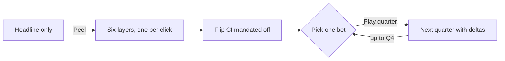

Script, about 8 minutes:

1. On slide 21, paste the Colab 2 link. Show the headline only and ask the chat: is this platform healthy? (1 min)
2. Peel together on your screen: voluntary vs mandated, satisfaction, workarounds. CI is the golden cage (2 min).
3. Flip "CI mandated" off: adoption drops, satisfaction doesn't move. The number was measuring obedience (1 min).
4. Play Q2 together: ask the chat which bet to fund, play it, read the deltas out loud (2 min).
5. Let them play Q3 and Q4 on their own, then read the room tally: what did most people fund first? (2 min)

The aha moments: the same capability sits top on adoption and bottom on satisfaction, and "onboard the next wave" spreads the pain instead of the platform. Slide 23 debriefs it. Backup: the Spaces link and the saved notebook outputs.

## Demo 3, rollout simulator: mandate vs make it easy (slides 26 to 28, about 8 min)

The point: mandating the tool buys fast numbers and hides workarounds, paving the path buys honest but slower adoption, and mandating the outcome while paving the path gets both. Three fictional divisions roll out the same pipeline, and the audience calls out slider values in the chat. App behaviour is in the demo build spec (Colab 3).

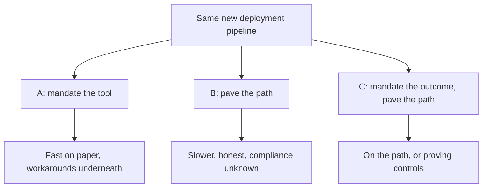

Script, about 8 minutes:

1. On slide 26, paste the Colab 3 link and ask the chat two questions: which division has the most services on the new pipeline at month 6, and which has the fewest hidden compliance gaps? (1 min)
2. Run the defaults: A hits its number at the deadline, B climbs slower, C tracks B and pulls ahead once controls apply (2 min).
3. Ask the chat for a quality value and set it: A's line doesn't move but its workarounds jump, B slows, C still has everyone covered (2 min).
4. Add pilots, raise the champion effect, set a sunset month: B and C catch up (2 min).
5. Back to their chat answers, then slide 28: C is the answer for a bank (1 min).

The aha moment is step 3: the quality slider moves A's workarounds, not its adoption line. The Vol 4 adoption split (36.6% mandate vs 28.2% genuine pull) backs it with real data on slide 24.

Comparison to have on hand for the debrief:

|  | A: mandate the tool | B: pave the path | C: mandate the outcome, pave the path |
| --- | --- | --- | --- |
| Early numbers | Fast on paper | Slower, grows through champions | Like B, then faster after the deadline |
| When v1 is worse | Workarounds, wrapper scripts, shadow IT | Teams stay off it and tell you why | Teams stay off it but must prove controls, so the pressure lands on fixing v1 |
| What the adoption % means | Very little | Real signal of value | Real signal of value |
| Compliance picture | Uniform on paper, gaps hidden | Off-path teams unknown | Everyone covered: on the path, or proving controls |

## Opening (slides 1 to 3, 7 min)

### Slide 1 · Platform Engineering Foundations

Layout: title slide. Subtitle: Barclays · 2 hours · three modules, three demos.

Say: quick intro, then ask everyone to keep the Teams chat open. They'll use three small apps from their browser today.

### Slide 2 · Today's route

Layout: full diagram.

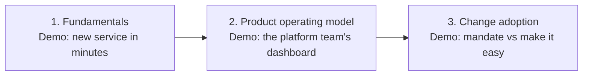

Say: every module ends in something you'll see working, not just slides.

### Slide 3 · The ticket test

Layout: points left, diagram right. Left side is a question for the Teams chat: how long from "I need a new service" to running in production?

- Under a day
- About a week
- About a month
- Longer, and it involves tickets

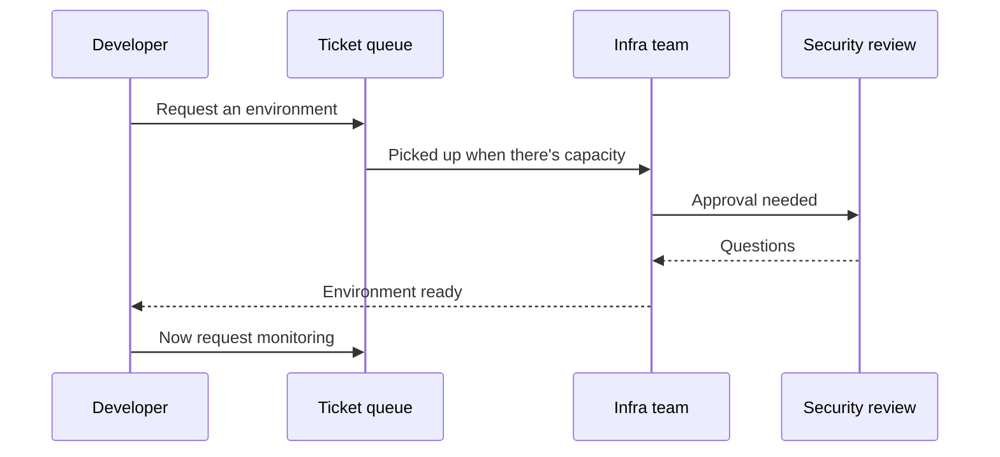

Say: keep your answer in mind, in about 30 minutes we do it live without a ticket.

Source: [platformengineering.com: We renamed the DevOps team](https://platformengineering.com/features/we-renamed-the-devops-team-platform-engineering-nothing-changed-heres-why/)

## Module 1: Platform Engineering Fundamentals (slides 4 to 12, 33 min)

### Slide 4 · Why platforms, why now

Layout: points left, diagram right.

- 90% of orgs run an internal platform, 76% have a dedicated team (DORA 2025)
- DevOps gave teams autonomy, and with it cost, risk and duplication
- Why now: AI amplifies platform quality, good or bad (DORA 2025)
- In banks the real driver is governance, not speed

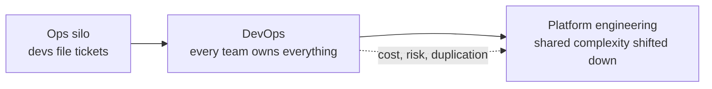

Say: nearly everyone already has some kind of platform. Today's question is whether yours removes work or just moves it. And DORA 2025 found AI only pays off when the platform underneath is good.

Source: [Google Cloud: 2025 DORA Report](https://cloud.google.com/blog/products/ai-machine-learning/announcing-the-2025-dora-report), [CNCF Platforms White Paper](https://tag-app-delivery.cncf.io/whitepapers/platforms/), [DX: 2024 DORA highlights](https://getdx.com/blog/2024-dora-report/)

### Slide 5 · Ops vs DevOps vs platform engineering

Layout: full diagram.

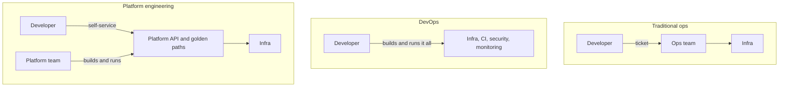

Say: DevOps is the culture, platform engineering is the structure that scales it past a handful of teams.

Source: [CNCF Platforms White Paper](https://tag-app-delivery.cncf.io/whitepapers/platforms/), [DORA capability page](https://dora.dev/capabilities/platform-engineering/)

### Slide 6 · It's not a rebrand if it passes the ticket test

Layout: points left, diagram right.

- Test: provision, deploy and monitor without raising a ticket
- A renamed ops team running a queue is a bottleneck with a new name
- DORA 2024: productivity up, but about 8% less throughput and 14% less stability early on
- Tell sponsors about the J-curve before they see the dip

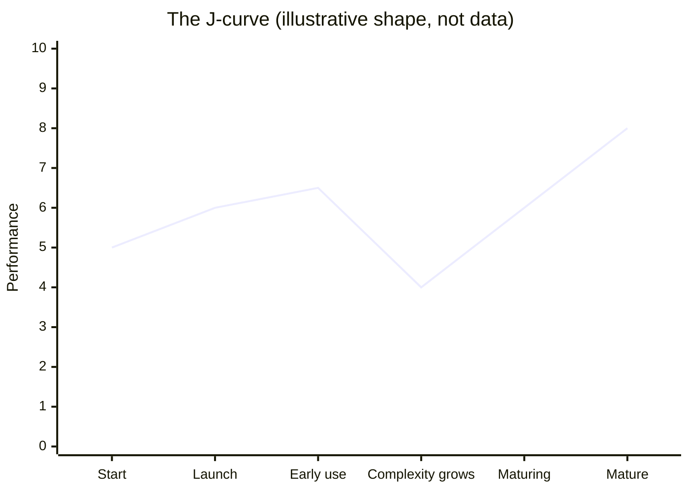

Say: if your platform team runs a ticket queue, you have ops with a new name. And warn your sponsors now: it dips before it gets better.

Source: [DORA capability page](https://dora.dev/capabilities/platform-engineering/), [platformengineering.com: We renamed the DevOps team](https://platformengineering.com/features/we-renamed-the-devops-team-platform-engineering-nothing-changed-heres-why/), [DORA 2024 report](https://dora.dev/research/2024/dora-report/)

### Slide 7 · What an IDP actually is

Layout: points left, diagram right.

- Capabilities, plus the interfaces to use them
- The portal is one interface, not the platform
- Build the thinnest layer over managed services
- Optional and composable, secure by default

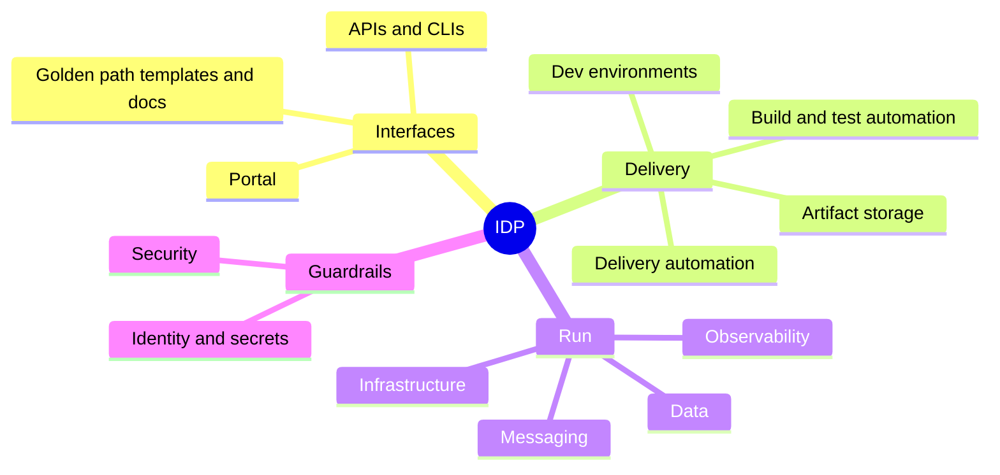

Say: these are CNCF's 13 capability domains (the grouping is ours). Nobody builds all 13 first.

Source: [CNCF Platforms White Paper](https://tag-app-delivery.cncf.io/whitepapers/platforms/), [KubeWright: Backstage is not your platform](https://kubewright.co.uk/blog/backstage-is-not-your-platform/)

### Slide 8 · Reference architecture: five planes

Layout: full diagram. Use the drawn version from the research doc, or this one.

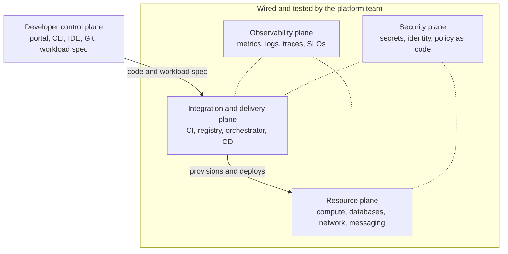

Say: devs live in the top plane. For a bank, the security plane is the one that sells it.

Source: [McKinsey Digital: Platform as code](https://medium.com/digital-mckinsey/platform-as-code-reference-architectures-to-simplify-developer-platforms-f2fb48e0c874), [DevOps.com: IDP reference architectures](https://devops.com/internal-developer-platform-idp-reference-architectures/), [State of Platform Engineering Vol 4 (PDF)](https://5890440.fs1.hubspotusercontent-eu1.net/hubfs/5890440/State%20of%20Platform%20Engineering%20Vol%204%202025.pdf), [Humanitec developer docs](https://developer.humanitec.com/app-humanitec-io/guides/getting-started/master-your-internal-developer-platform/structure-and-integration-points/)

### Slide 9 · Anatomy of a golden path

Layout: points left, diagram right.

- Opinionated and supported (Spotify's definition)
- Covers the common 80%, not everything
- Defaults you can override
- Fails with a clear error and the fix

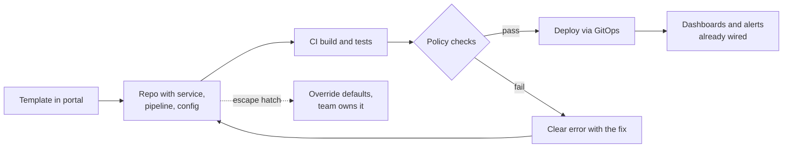

Say: Spotify built golden paths to kill "rumour-driven development". Opinionated, supported, and you can still step off it as long as you own what you change.

Source: [Spotify Engineering: Golden Paths](https://engineering.atspotify.com/2020/08/how-we-use-golden-paths-to-solve-fragmentation-in-our-software-ecosystem), [State of Platform Engineering Vol 4 (PDF)](https://5890440.fs1.hubspotusercontent-eu1.net/hubfs/5890440/State%20of%20Platform%20Engineering%20Vol%204%202025.pdf), [platformengineering.org: Golden cage syndrome](https://platformengineering.org/blog/golden-cage-syndrome-why-internal-developer-platforms-fail)

### Slide 10 · Demo 1: new service in minutes

Layout: points left, diagram right. Then share Colab 1 and run Demo 1; slides 11 and 12 debrief it.

- Open the Colab 1 link in the Teams chat
- Create a service: three fields, the rest is defaults
- Then break it: Confidential data, Public internet
- Watch the room catalog fill up

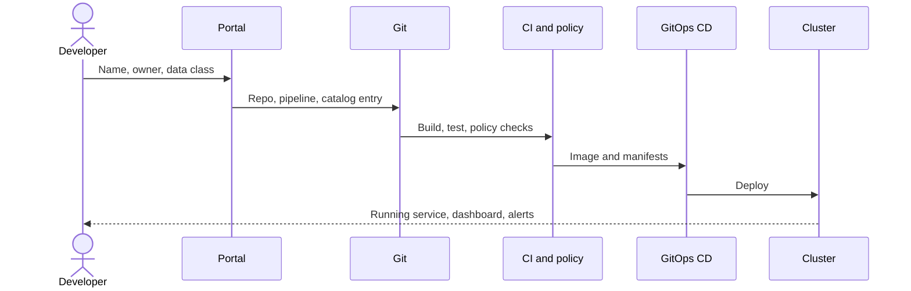

Say: paste the Colab 1 link in the chat now, then run the Demo 1 playbook: create, break, fix, room catalog, then the Actions page on your screen.

Source: [State of Platform Engineering Vol 4 (PDF)](https://5890440.fs1.hubspotusercontent-eu1.net/hubfs/5890440/State%20of%20Platform%20Engineering%20Vol%204%202025.pdf), [Spotify Engineering: Golden Paths](https://engineering.atspotify.com/2020/08/how-we-use-golden-paths-to-solve-fragmentation-in-our-software-ecosystem)

### Slide 11 · When a rule breaks

Layout: points left, diagram right.

- Same request, marked confidential with public ingress
- The policy check fails in the pipeline, not in a review meeting
- The error says what's wrong and how to fix it
- One line changes, and it passes

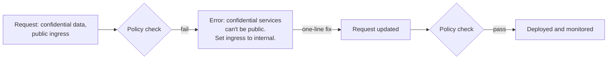

Say: DORA 2025 found clear feedback on task outcome is the platform capability most tied to a good developer experience. In a bank, this is also the moment security stops being a meeting.

Source: [DORA capability page](https://dora.dev/capabilities/platform-engineering/), [platformengineering.org: Golden cage syndrome](https://platformengineering.org/blog/golden-cage-syndrome-why-internal-developer-platforms-fail)

### Slide 12 · Debrief: what just happened

Layout: points left, diagram right.

- No ticket, no queue
- Controls ran inside the path, not after it
- The failure told us exactly what to fix
- Every step is a Git commit: that's the audit trail

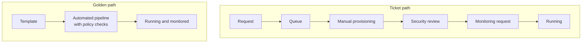

Say: go back to what people answered on slide 3. That gap is the business case.

Source: [platformengineering.com: We renamed the DevOps team](https://platformengineering.com/features/we-renamed-the-devops-team-platform-engineering-nothing-changed-heres-why/), [State of Platform Engineering Vol 4 (PDF)](https://5890440.fs1.hubspotusercontent-eu1.net/hubfs/5890440/State%20of%20Platform%20Engineering%20Vol%204%202025.pdf)

## Module 2: Product Operating Models for Platform Teams (slides 13 to 23, 35 min)

### Slide 13 · From project to product

Layout: points left, diagram right.

- A platform is an internal product, developers are its customers
- One named product owner, not a committee
- Research real developer journeys before building
- Ship thin, measure, reprioritise

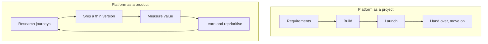

Say: a project ends at launch, a product starts there. Researching real journeys is the step most platform teams skip.

Source: [DORA capability page](https://dora.dev/capabilities/platform-engineering/), [Martin Fowler / Evan Bottcher](https://martinfowler.com/articles/talk-about-platforms.html)

### Slide 14 · How the platform team works with everyone else

Layout: points left, diagram right.

- Collaborate while a capability is still being discovered
- Move to X-as-a-Service once it's stable
- Facilitate when a team needs uplift
- Start with a Thinnest Viable Platform, even a wiki page

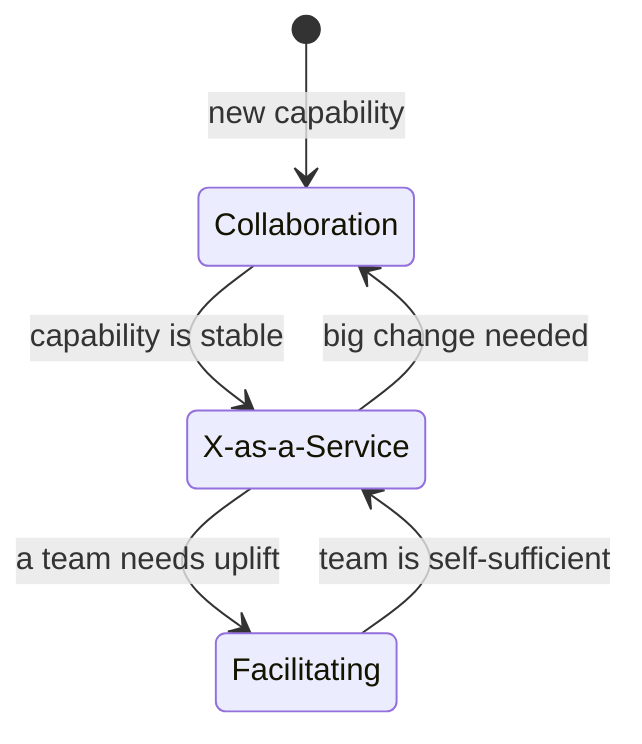

Say: the Thinnest Viable Platform can literally be a wiki page listing what you offer and how to get help. Start there, not with a portal.

Source: [Team Topologies: TVP](https://teamtopologies.com/key-concepts-content/what-is-a-thinnest-viable-platform-tvp), [Team Topologies: TVP wiki template](https://github.com/TeamTopologies/Thin-platform-template), [Umbrex: Team Topologies summary](https://umbrex.com/resources/frameworks/organization-frameworks/team-topologies/)

### Slide 15 · Buyer vs user

Layout: points left, diagram right.

- Buyers (CIO, risk, compliance) fund it and set the controls
- Users (engineers) live with it every day
- The owner balances both and needs authority to say no
- Users are captive, so build proxies for choice

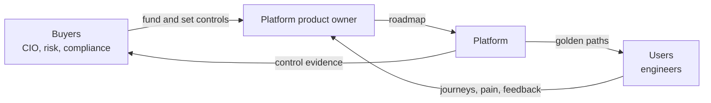

Say: engineers feel this tension every time a new control lands on them. The platform owner's job is to absorb it, not pass it on.

Source: [Practitioner thread: rebranding platform teams?](https://tianpan.co/forum/t/platform-as-product-are-we-actually-treating-developers-like-customers-or-just-rebranding-platform-teams/2574), [Practitioner thread: customers can't leave](https://tianpan.co/forum/t/platform-as-product-sounds-great-until-you-realize-your-customers-cant-leave/1879)

### Slide 16 · Who owns the platform product today

Layout: points left, diagram right.

- Only 36.6% have a dedicated Platform PM
- 38% rely on engineers "thinking like PMs"
- 25.4% have no product mindset at all
- The report's top recommendation: a dedicated Platform PM

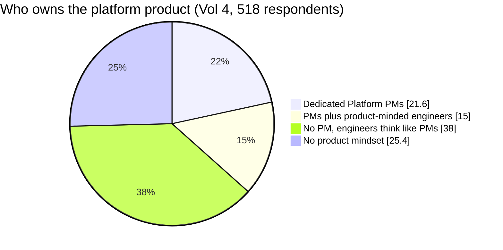

Say: most orgs rely on engineers to "think like PMs". That's usually where the roadmap turns back into a ticket queue.

Source: [State of Platform Engineering Vol 4 (PDF)](https://5890440.fs1.hubspotusercontent-eu1.net/hubfs/5890440/State%20of%20Platform%20Engineering%20Vol%204%202025.pdf)

### Slide 17 · Build the roadmap from developer journeys

Layout: points left, diagram right.

- Rank journeys by how often they happen and how much they hurt
- Start with the most frequent painful one
- Product work and ticket interrupts in separate lanes
- Ask the chat: which journey hurts most at your team?

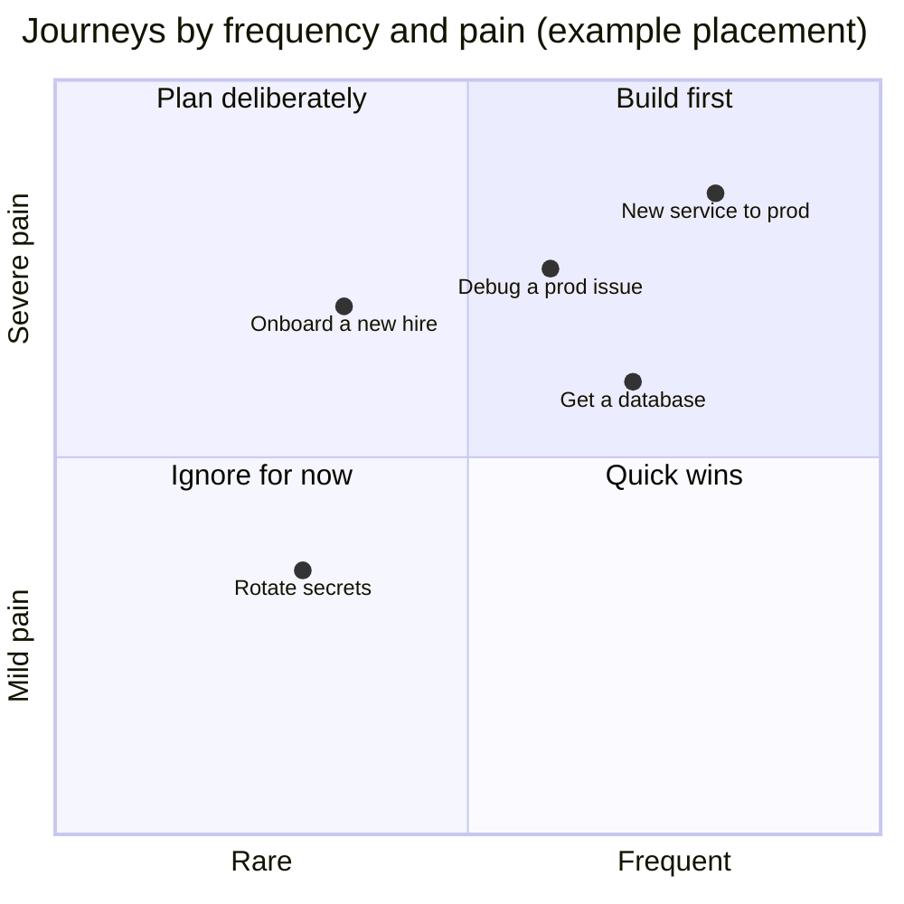

Say: the dots are placeholders. Move them live based on what the chat says.

Source: [DORA capability page](https://dora.dev/capabilities/platform-engineering/), [Bryan Finster: Platform as a Product principles](https://bryanfinster.substack.com/p/platform-as-a-product-minimum-viable)

### Slide 18 · The platform API is the product

Layout: points left, diagram right.

- Declarative, versioned, stored in Git
- Portal, CLI, IDE and AI assistants are skins on top
- Swap the implementation without breaking the contract
- Banks already do this (Millennium bcp on Crossplane)

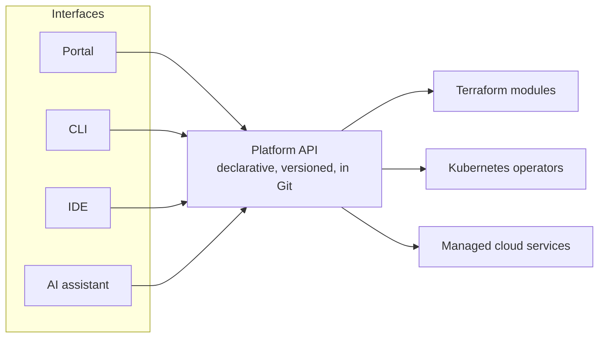

Say: the API is the contract you version and keep stable. The portal is just one way in. Millennium bcp, a bank, runs self-service on Crossplane this way.

Source: [Crossplane adopters](https://github.com/crossplane/crossplane/blob/v1.16.0/ADOPTERS.md), [Syntasso: platform APIs](https://www.syntasso.io/post/turn-helm-charts-into-scalable-platform-apis-with-kratix)

### Slide 19 · Golden path vs golden cage

Layout: points left, diagram right.

- Earned vs mandatory
- Override when needed vs no escape hatch
- Clear error with the fix vs cryptic wrapper error
- Teams contribute vs the central team approves everything

```mermaid
flowchart LR
  subgraph Path["Golden path"]
    g1[Defaults] --> g2[Override when needed]
    g1 --> g3[Clear error with the fix]
    g1 --> g4[Teams contribute templates]
  end
  subgraph Cage["Golden cage"]
    c1[Mandatory abstraction] --> c2[No escape hatch]
    c1 --> c3[Cryptic wrapper error]
    c1 --> c4[Central team approves all]
  end
```

Say: the golden cage test is one question. If this were optional tomorrow, would people still use it?

Source: [platformengineering.org: Golden cage syndrome](https://platformengineering.org/blog/golden-cage-syndrome-why-internal-developer-platforms-fail), [DORA capability page](https://dora.dev/capabilities/platform-engineering/)

### Slide 20 · Why one metric lies

Layout: points left, diagram right.

- DORA alone would have called 2024 platforms a failure
- 36.6% of adoption is driven by mandates
- 29.6% of platform teams measure nothing
- Measure teams, never individuals

```mermaid
flowchart TB
  L1["Adoption<br/>voluntary vs mandated"]
  L2["Onboarding speed<br/>idea to first prod deploy"]
  L3["Experience<br/>feedback loops, cognitive load, flow"]
  L4["Delivery outcomes<br/>DORA, on vs off platform"]
  L5["Health and control evidence<br/>workarounds, policy pass rate"]
  L1 ~~~ L2 ~~~ L3 ~~~ L4 ~~~ L5
```

Say: DORA alone would have called 2024's platforms a failure. You need all five layers, and never use them to rank individuals.

Source: [DORA 2024 report](https://dora.dev/research/2024/dora-report/), [State of Platform Engineering Vol 4 (PDF)](https://5890440.fs1.hubspotusercontent-eu1.net/hubfs/5890440/State%20of%20Platform%20Engineering%20Vol%204%202025.pdf), [Pragmatic Engineer](https://newsletter.pragmaticengineer.com/p/measuring-developer-productivity)

### Slide 21 · Demo 2: the platform team's dashboard

Layout: points left, diagram right.

- Open the Colab 2 link in the Teams chat
- Fictional division, synthetic data
- Peel the layers, then flip the mandate switch
- Fund one bet per quarter, four quarters

```mermaid
flowchart LR
  S1[Service catalog] --> A[Adoption]
  S2[Pipeline timestamps] --> O[Onboarding speed]
  S3[DevEx survey] --> E[Experience]
  S4[Delivery and incident data] --> D[Delivery outcomes]
  S5[Support queue and policy engine] --> H[Health and controls]
  A --> R{Next quarter's bet}
  O --> R
  E --> R
  D --> R
  H --> R
```

Say: paste the Colab 2 link. We peel it together first, then you each fund one bet per quarter.

Source: [DORA capability page](https://dora.dev/capabilities/platform-engineering/), [Google Cloud: Combining DORA and HEART](https://cloud.google.com/transform/unlocking-product-success-by-combining-dora-and-heart/), [ACM Queue: DevEx](https://queue.acm.org/detail.cfm?id=3595878)

### Slide 22 · Live in Colab

Layout: holding slide with the dashboard flow diagram, then share Colab 2 and run it as in the Demo 2 playbook above.

```mermaid
flowchart LR
  H[Headline only] -->|Peel| L["Six layers, one per click"]
  L --> T[Flip CI mandated off]
  T --> B{Pick one bet}
  B -->|Play quarter| N[Next quarter with deltas]
  N -->|up to Q4| B
```

Say: headline first, ask the chat if it's healthy, then peel. Script in the Demo 2 playbook.

Source: [State of Platform Engineering Vol 4 (PDF)](https://5890440.fs1.hubspotusercontent-eu1.net/hubfs/5890440/State%20of%20Platform%20Engineering%20Vol%204%202025.pdf), [DORA capability page](https://dora.dev/capabilities/platform-engineering/)

### Slide 23 · Debrief: read adoption and satisfaction together

Layout: points left, diagram right.

- High adoption, low satisfaction: probably a golden cage
- Low adoption, high satisfaction: a hidden gem, market it
- Pair every system metric with a survey question
- Compare teams on vs off the platform

```mermaid
quadrantChart
  title Adoption vs satisfaction (synthetic demo data)
  x-axis Low adoption --> High adoption
  y-axis Low satisfaction --> High satisfaction
  quadrant-1 Healthy product
  quadrant-2 Hidden gem
  quadrant-3 Rethink or retire
  quadrant-4 Likely a golden cage
  CI pipelines: [0.85, 0.25]
  Databases: [0.65, 0.75]
  Secrets: [0.3, 0.8]
  Preview environments: [0.2, 0.3]
```

Say: CI sits in the golden cage corner, top on adoption and bottom on satisfaction. Ask the chat which bet they funded first and what it did.

Source: [ACM Queue: DevEx](https://queue.acm.org/detail.cfm?id=3595878), [DORA capability page](https://dora.dev/capabilities/platform-engineering/), [Practitioner thread: customers can't leave](https://tianpan.co/forum/t/platform-as-product-sounds-great-until-you-realize-your-customers-cant-leave/1879)

## Module 3: Change Adoption Basics (slides 24 to 29, 28 min)

### Slide 24 · How adoption actually happens

Layout: points left, diagram right.

- 36.6% of platforms are adopted by mandate
- Only 28.2% get genuine pull
- 18.3% get users contributing back
- Adoption is the top challenge platform teams report

```mermaid
pie showData
  title How platform adoption happens (Vol 4)
  "Mandate (extrinsic push)" : 36.6
  "Genuine pull (intrinsic)" : 28.2
  "Participatory (users contribute)" : 18.3
  "Erratic, no strategy" : 16.9
```

Say: more than a third of platforms are adopted because someone said so. That's exactly what the next demo is about.

Source: [State of Platform Engineering Vol 4 (PDF)](https://5890440.fs1.hubspotusercontent-eu1.net/hubfs/5890440/State%20of%20Platform%20Engineering%20Vol%204%202025.pdf)

### Slide 25 · Four barriers that stall adoption

Layout: full diagram.

```mermaid
flowchart LR
  B1[Built without asking users] --> S1[Solves problems nobody has]
  B2["Slow v1 in the J-curve dip"] --> S2[Teams wait it out]
  B3["Golden cage, no escape hatch"] --> S3[Workarounds and shadow IT]
  B4["No sponsor, buyer and user pulling apart"] --> S4[Funding cut before value shows]
```

Say: none of these are technical. Vol 4 says cultural barriers outweigh technical ones.

Source: [DORA capability page](https://dora.dev/capabilities/platform-engineering/), [CNCF Platforms White Paper](https://tag-app-delivery.cncf.io/whitepapers/platforms/), [State of Platform Engineering Vol 4 (PDF)](https://5890440.fs1.hubspotusercontent-eu1.net/hubfs/5890440/State%20of%20Platform%20Engineering%20Vol%204%202025.pdf), [platformengineering.org: Golden cage syndrome](https://platformengineering.org/blog/golden-cage-syndrome-why-internal-developer-platforms-fail)

### Slide 26 · Demo 3: three ways to roll out the same tool

Layout: points left, diagram right.

- A mandates the tool with a deadline
- B pilots, paves the path, grows champions
- C mandates the outcome and paves the path
- Ask the chat: who's better off at month 6?

```mermaid
flowchart TB
  T[Same new deployment pipeline] --> A["Division A<br/>mandate the tool"]
  T --> B["Division B<br/>pave the path"]
  T --> C["Division C<br/>mandate the outcome, pave the path"]
  A --> Q{Month 6: who's better off?}
  B --> Q
  C --> Q
```

Say: paste the Colab 3 link, then ask the chat both questions before anyone touches a slider.

Source: [Dianne Marsh: The Paved Road at Netflix](https://www.slideshare.net/diannemarsh/the-paved-road-at-netflix), [Practitioner thread: customers can't leave](https://tianpan.co/forum/t/platform-as-product-sounds-great-until-you-realize-your-customers-cant-leave/1879), [CNCF Platforms White Paper](https://tag-app-delivery.cncf.io/whitepapers/platforms/)

### Slide 27 · Live: the rollout simulator

Layout: full diagram as the holding slide, then share Colab 3. The timeline is the story the simulator reproduces, so if the Colab misbehaves, walk the timeline instead.

```mermaid
timeline
  title Three rollouts of the same pipeline (illustrative scenario)
  section Division A, mandate the tool
    Month 1 : Deadline announced : Teams migrate under pressure
    Month 3 : High adoption on paper : Wrapper scripts appear
    Month 6 : Complaints go quiet : Gaps hidden in workarounds
  section Division B, pave the path
    Month 1 : Three pilot teams : Built with them
    Month 3 : Before and after numbers published : Champions demo it
    Month 6 : Next wave pulls it in : Old path gets a sunset date
  section Division C, mandate the outcome
    Month 1 : Controls announced with a deadline : Pilots build the golden path
    Month 3 : Golden path meets the controls by default : Off-path teams start proving their own
    Month 6 : Most teams on the path : Everyone else provably compliant
```

Say: run the Demo 3 playbook. If the Colab misbehaves, walk this timeline instead.

Source: [CNCF Platforms White Paper](https://tag-app-delivery.cncf.io/whitepapers/platforms/), [DORA capability page](https://dora.dev/capabilities/platform-engineering/), [Netflix Tech Blog: Scaling AppSec](https://netflixtechblog.medium.com/scaling-appsec-at-netflix-6a13d7ab6043)

### Slide 28 · Debrief: mandate the outcome, pave the path

Layout: points left, diagram right.

- Mandates buy numbers, paving buys signal
- In a bank, mandate the control set, not the tool
- Off-path teams prove the controls themselves
- Paved road adoption is itself a risk control

```mermaid
flowchart LR
  M["Mandated outcome<br/>control set for every prod service"] --> Q{How will a team comply?}
  Q -->|golden path| G["Controls built in,<br/>evidence automatic"]
  Q -->|own route| O["Team proves each control<br/>and carries the cost"]
  G --> W[The paved road becomes the easy, obvious choice]
```

Say: C is the answer for a bank. Mandate the controls, then make the golden path the cheapest way to meet them.

Source: [Netflix Tech Blog: Scaling AppSec](https://netflixtechblog.medium.com/scaling-appsec-at-netflix-6a13d7ab6043), [CNCF Platforms White Paper](https://tag-app-delivery.cncf.io/whitepapers/platforms/)

### Slide 29 · Early adoption playbook

Layout: full diagram.

```mermaid
flowchart TB
  s1[Pick one frequent, painful journey] --> s2[Build with 2 to 3 pilot teams]
  s2 --> s3[Ship a thin version in weeks]
  s3 --> s4[Publish before and after numbers]
  s4 --> s5[Pilots become champions]
  s5 --> s6[Next wave with enabling support]
  s6 --> s7[Only then, sunset the old path]
```

Say: this is the one slide to screenshot if they remember nothing else from Module 3.

Source: [CNCF Platforms White Paper](https://tag-app-delivery.cncf.io/whitepapers/platforms/), [Umbrex: Team Topologies summary](https://umbrex.com/resources/frameworks/organization-frameworks/team-topologies/), [DORA capability page](https://dora.dev/capabilities/platform-engineering/)

## Wrap-up (slides 30 to 31, 12 min)

### Slide 30 · What to take back

Layout: points left, diagram right.

- Pass the ticket test before building anything fancy
- Run it as a product, with a real owner
- Measure in layers, never one number
- Mandate the outcome, pave the path

```mermaid
flowchart TB
  a[Remove tickets and cognitive load] --> b[Build what developer journeys call for]
  b --> c[Run it as a product]
  c --> d["Versioned API, golden paths,<br/>layered scorecard"]
  d --> e[Mandate the outcome, pave the path]
  e --> f["At Barclays: governance first,<br/>several platforms, shared standards"]
```

Say: this is the same chain the research went through, so every step has evidence behind it.

Source: [DORA capability page](https://dora.dev/capabilities/platform-engineering/), [CNCF Platforms White Paper](https://tag-app-delivery.cncf.io/whitepapers/platforms/), [State of Platform Engineering Vol 4 (PDF)](https://5890440.fs1.hubspotusercontent-eu1.net/hubfs/5890440/State%20of%20Platform%20Engineering%20Vol%204%202025.pdf)

### Slide 31 · Q&A, and one thing to do this week

Layout: points left, diagram right. Left side is further reading.

- [CNCF Platforms White Paper](https://tag-app-delivery.cncf.io/whitepapers/platforms/)
- [DORA: platform engineering capability](https://dora.dev/capabilities/platform-engineering/)
- [Team Topologies: Thinnest Viable Platform](https://teamtopologies.com/key-concepts-content/what-is-a-thinnest-viable-platform-tvp)
- [State of Platform Engineering Vol 4](https://5890440.fs1.hubspotusercontent-eu1.net/hubfs/5890440/State%20of%20Platform%20Engineering%20Vol%204%202025.pdf)

```mermaid
flowchart LR
  j[Pick one painful journey] --> o[Name its owner]
  o --> m[Baseline it today]
  m --> p[Find 2 pilot teams]
```

Say: pick one painful journey this week and name who owns it. That's how every platform on these slides started.

## Open decisions before building the deck

Settled: Teams chat questions (no poll tool), engineering audience, AI why-now on slide 4, gradio.live links with Spaces backup, 10 minutes for Demo 1 with a room catalog, funding game in Colab 2, Division C in Colab 3, every slide has speaker notes.

1. Demo 1: showing a pre-run GitHub Actions run on your screen at the end (in the playbook, pending your OK).
2. Is a mandated rollout under way at Barclays right now? If yes, lean on Division C and frame Demo 3 around mandating outcomes, not tools.
3. Check gradio.live and hf.space load on Barclays laptops.
4. Build the deck in Claude Code once the three Colabs work, so demo screenshots can go in the hidden backup slides.
